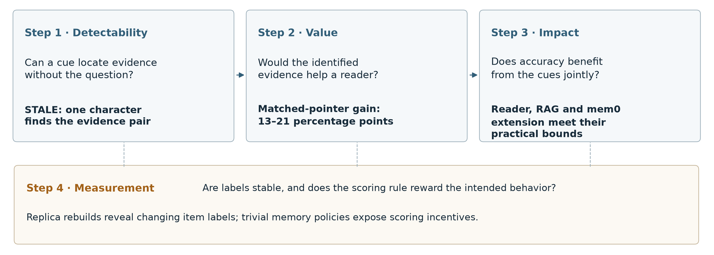

# Finding the Evidence Without the Question: Auditing Agent-Memory Benchmarks

Özgür Uğurlu

## Abstract

Agent-memory benchmarks test whether a system can find and use the right information in a long conversation history. We show that several of these benchmarks contain construction and scoring flaws that can make their results misleading, and we propose an audit to detect such flaws. Applied to eight benchmarks, the audit finds that in STALE a single character, the curly apostrophe, marks every answer-bearing session and none of the 19,200 distractors; that LoCoMo-Plus evidence can be told apart from the surrounding conversation by writing style alone; that rebuilding the same memory pipeline changes about 16% of item labels while overall accuracy varies by only about one point; and that ForgetEval's scoring rule rewards a policy that wipes memory. BEAM passes the audit. The STALE shortcut is valuable: telling a reader which sessions it marks raises accuracy by 13–21 points, although removing it together with session clock times changes the accuracy of the three systems we tested by at most a few points. We release the audit as a checklist and an open offline toolkit, memaudit.

## 1. Introduction

A single character can locate STALE's evidence without reading its questions. The curly apostrophe, U+2019, occurs in all 800 answer-bearing sessions and none of the 19,200 distractors. A rule that searches for that character therefore recovers the relevant pair in every scenario. It needs neither semantic retrieval nor an understanding of what the user asked.

This matters because agent-memory benchmarks are intended to measure useful recall and reasoning over past interactions. In STALE, an earlier conversation establishes a fact about a user and a later one implicitly changes it. A system must find both conversations and answer using the updated state [@Chao2026STALE]. A construction cue that singles out those conversations gives a system a way to skip part of that task.

For example, suppose an early session says the user is vegetarian, a later one mentions their new favorite meal of beef steak, and 48 unrelated sessions surround them; a question then asks what meal to recommend now. A short note could name the earlier and later sessions for a reader that sees the whole history. The answer should follow the later steak preference; a note naming both sessions makes the update easy to find.

We propose a four-step audit for agent-memory benchmarks. Step 1 asks whether evidence can be found without the question. Step 2 measures how much that shortcut would be worth. Step 3 tests whether the systems' scores depend on it. Step 4 checks whether the measurement itself can support comparisons, through repeated pipeline builds and tests of the scoring rule. Figure 1 outlines the protocol.

**Figure 1. The audit's four steps.** Step 1 looks for question-blind evidence cues. Step 2 measures the value of the evidence they identify. Step 3 removes the cues to test score dependence. Step 4 checks replica stability and scoring incentives. Each step needs its own comparison.

**The audit at a glance.**

| Step | What it found | Key number |
|---|---|---|
| 1. Find evidence without the question | STALE reveals evidence; LoCoMo-Plus evidence is separable by style; BEAM matches fair nulls. | STALE: one character |
| 2. Measure shortcut value | Naming STALE's evidence beats matched retrieval notes. | +13–21 points; four readers |
| 3. Test score dependence | Joint removal bounds net benefits in the tested systems. | Upper bounds: reader ≈3.8, RAG ≈1.6, mem0 extension ≈1.4 points |
| 4. Check measurement | Replica labels change; ForgetEval rewards wiping memory. | ≈16% disagreement; ≈1-point accuracy standard deviation |

The audit finds construction flaws that reveal evidence, changing replica labels and a scoring rule that rewards wiping memory. It also identifies a passing case: BEAM's wrong-question retrieval matches fair nulls. In STALE, the shortcut is both present and valuable, yet the tested systems show no large benefit from it. That result is why the audit includes an impact step: a visible construction flaw alone does not establish score inflation.

We contribute (1) an audit protocol with fair baselines and controls; (2) findings on STALE, LoCoMo-Plus, ForgetEval and replica label instability, including a shortcut created by our own HaluMem adaptation and a passing case in BEAM; (3) an impact check on STALE; and (4) a benchmark-building checklist and the offline toolkit memaudit. Appendix I gives the study map and validation summary.

## 2. Related work

Question-blind auditing extends established tests of whether a benchmark can be solved from incomplete inputs. Hypothesis-only natural-language inference and question-only reading-comprehension baselines exposed annotation artifacts [@Gururangan2018AnnotationArtifacts; @Poliak2018HypothesisOnly; @KaushikLipton2018ReadingComprehension]. Shortcut-learning studies explain why a successful predictor need not learn the intended task [@Geirhos2020ShortcutLearning], while failed partial-input baselines do not certify artifact-free data [@Feng2019Misleading]. Adversarial distractors and contrast sets motivate interventions that change a suspected shortcut [@JiangBansal2019Shortcuts; @Gardner2020ContrastSets]. Our audit protocol connects evidence detection, the value of exact retrieval, score dependence and measurement checks, with a separate comparison for each step.

Long-history benchmarks include LoCoMo, LongMemEval and STALE [@Maharana2024LoCoMo; @Wu2025LongMemEval; @Chao2026STALE]. They evaluate systems that compress, retrieve or update conversational memory, including Mem0 [@Chhikara2025Mem0]. Reader behavior also depends on evidence position, distracting context and presentation [@Liu2024LostMiddle; @Shi2023Distracted; @Sclar2024Spurious]. Concurrent work tests memory-size leakage and query-conditioned presentation controls [@Mondal2026BeforeAnswering; @Jiang2026Presentation; @Si2026Render]. We instead begin with question-blind evidence labels and use benchmark-specific nulls before testing downstream behavior. Query-independent document advantages already have a long history in information retrieval [@Singhal1996Pivoted; @Kraaij2002Priors].

LLM judges can disagree with humans, prefer particular outputs, and respond to presentation [@Zheng2023MTBench; @Thakur2024JudgingJudges; @Panickssery2024SelfPreference]. Prediction churn and underspecification also show that stable aggregate accuracy can coexist with unstable item predictions [@MilaniFard2016Churn; @DAmour2022Underspecification]. Our replica study expresses this instability as disagreement and an oracle union over repeated builds; the latter is related to pass-at-k coverage [@Chen2021PassAtK]. We use a gain derived from Sharma and Lall's released labels as a reference scale [@SharmaLall2026Selection].

## 3. Setup: each audit step needs its own comparison

The audit separates evidence detectability, shortcut value, score dependence and measurement reliability. A session is a conversation segment; a turn is one message. The unit being ranked can be a session or a turn, depending on the benchmark. A candidate pool is the set of units available for a particular item. Table 1 summarizes the audited settings.

**Table 1. Benchmark coverage.** This table covers eight benchmarks in all. Seven appear in the evidence audit, which has nine settings because BEAM has three scales. MemOps appears in the atlas only; the atlas replaces PersonaMem-v2 with MemOps. These are selected settings with tractable adapters, not a prevalence sample. Construction summaries, populations and adapters are in Appendices A, E and K.

| Benchmark | Evidence-audit unit | Construction and coverage |
|---|---|---|
| STALE [@Chao2026STALE] | Session | Generated, edited evidence mixed with LongMemEval distractors; evidence audit and atlas |
| LoCoMo-Plus [@Li2026LoCoMoPlus] | Turn | Generated cue dialogues inserted into LoCoMo hosts; audit and atlas |
| LongMemEval-S [@Wu2025LongMemEval] | Session | Simulated evidence with simulated and public-chat filler; audit and atlas |
| BEAM [@Tavakoli2025BEAM] | User turn | Generated conversations; contradiction-resolution and knowledge-update labels; audit and atlas |
| HaluMem-Medium [@Chen2025HaluMem] | Prefix session | Generated user histories adapted to prefix pools; audit and atlas |
| PersonaMem-v2 [@Jiang2025PersonaMemV2] | User message | Generated preference conversations; cached subset, audit only |
| LoCoMo [@Maharana2024LoCoMo] | Session | Generated, edited conversations; audit and atlas |
| MemOps [@Hao2026MemOps] | — | Evidence conversations mixed with distractors; atlas only |

**Question-blind evidence detection.** A detector is question-blind when it never sees the question. Our supervised classifier uses 31 style and role features, excluding question text, evidence identifiers and timestamps. Grouped cross-validation keeps related units together. We report the area under the ROC curve, or AUROC, averaged across candidate pools. A value of .5 is chance discrimination; 1 means perfect separation. This is classification of annotated evidence, not answer correctness. Appendices A and K specify the scored populations, duplicate exclusions and features.

**Fair nulls for unrelated questions.** A retriever can find an evidence unit even under an unrelated question because that unit is long, has many turns, or occupies a favored position. We therefore compare wrong-question retrieval with uniform chance, chance weighted by nonempty turn count, and matched non-evidence units with similar length, turn count and position. The retriever combines BM25 and dense rankings; a unit's score is its best turn score. The primary outcome is whether any evidence unit appears in the top five. Chance-corrected excess is the average of each item's excess hit rate divided by its remaining room above chance. Matched-placebo comparisons require adequate support: suitable control units must actually exist. Appendix E specifies the nulls and decision rules.

**The STALE task.** Each of its 400 scenarios contains 50 sessions: an old fact, a later implicit update and 48 distractors. Its three questions test the updated state, resistance to an outdated premise and advice that depends on the update. Reader-pointer experiments use a fixed 100-scenario test split. The reader already sees the full history. A pointer is an added note naming sessions selected by a retriever; the cue pointer instead names the pair found by the character rule. The principal comparison matches the note and the number of named sessions. Cue-removal experiments instead change the input typography and clock times, without adding a pointer.

**Readers and labels.** The four-vendor comparison uses GLM-5.3-Flash, Gemini 3.8 Flash, GPT-6.1 Sol and Muse Spark 1.3; GPT-6.1 Sol grades correctness for the primary analysis. The pipeline experiments use GLM-5.3-Flash for reading and judging; mem0 also uses it for extraction. Validation compares sampled answers with an additional model's grades, typically Claude Opus 5.5. The replica study rebuilds one bespoke pipeline on LoCoMo and compares the resulting labels. Appendix K summarizes the model and prompt settings.

**Analysis.** Pre-specified means the design and decision rules were fixed locally before each test run, without a public registration. We assess practical equivalence against a preset tolerance around zero. Bootstrap intervals resample whole scenarios or conversations to preserve dependence among their questions. Holm and Bonferroni adjustments control false positives across families of comparisons. Appendix I gives the study map and validation summary.

## 4. Step 1: some benchmarks reveal the evidence without the question

STALE and LoCoMo-Plus strongly separate evidence from distractors, while BEAM's wrong-question retrieval is equivalent to fair chance. The two findings come from different tests: the first identifies evidence features; the second asks whether unrelated questions retrieve evidence beyond a suitable baseline.

On STALE, the curly-apostrophe rule is exact on the distributed full histories. It selects the evidence pair in all 400 scenarios. This is simpler than training a classifier and shows why evidence construction deserves inspection before a downstream score is interpreted. The classifier also achieves perfect separation on its scored population (Figure 2).

LoCoMo-Plus shows a different stylistic pattern. None of its 758 cue turns contains an exclamation mark, whereas most host turns do. Its multifeature classifier is nearly perfect at distinguishing the two kinds of turn. Recovering every evidence turn for a question is a stricter task than separating the two distributions.

LongMemEval-S is less separable overall. Earlier fits find much stronger separation when evidence is compared with public-chat filler than with simulated filler. This descriptive association is consistent with different construction pipelines leaving different traces. LoCoMo is the weakest setting in the style audit.

**Figure 2. Evidence detectability varies across settings.** Points are macro within-pool AUROCs from 31-feature classifiers on held-out groups after test-duplicate exclusion; bars are saved 95% group-bootstrap intervals conditional on predictions. The dashed line marks chance. Source-construction colors identify documented differences between evidence and filler pipelines. Appendix A gives the scored populations, including the cached PersonaMem-v2 subset and the BEAM population discrepancy.

The atlas asks a stricter question about retrieval. In BEAM, unrelated questions retrieve evidence at almost the same rate as turn-weighted chance. Both its primary and matched-placebo comparisons meet the pre-specified equivalence criterion (Table 2; Figure 3). BEAM therefore supplies a negative control for the atlas.

Fair nulls also change LongMemEval-S's interpretation. Its wrong-question hit rate exceeds uniform chance, but weighting units by turn count accounts for much of the excess. A naive uniform baseline would attribute a mechanical opportunity advantage to something more distinctive.

The audit also catches a positional shortcut created by our own HaluMem adaptation. The pre-specified candidate histories ended at the later of the question's session and the latest evidence session. That rule often put evidence at the end, creating a positional shortcut. The prefix result reflects this adaptation choice. A descriptive check on full histories of the same items removes the cue-dominance flag and places retrieval near its fair null. Appendix E preserves both results.

**Table 2. Selected atlas comparisons.** Rates are percentages for any evidence in the top five. CE is chance-corrected excess over the turn-weighted null. BEAM's rates are item-weighted while its CE weights scales equally; CE is calculated per item, so it cannot in general be reconstructed from the displayed mean rates. The BEAM comparisons meet a ±.03 equivalence bound with Holm adjustment; the remaining rows use descriptive 95% intervals. Appendix E gives the atlas methods and support checks.

| Setting / comparison | Wrong-question rate | Null or placebo rate | CE [interval] |
|---|---:|---:|---|
| BEAM / turn-weighted null | 4.44 | 4.84 | −.004 [−.014, .006] |
| BEAM / matched placebos | — | — | −.007 [−.020, .006] |
| LongMemEval-S / turn-weighted null | 22.04 | 21.06 | .011 [−.017, .041] |
| HaluMem / full-history sensitivity | 7.71 | 8.11 | −.005 [−.015, .006] |

**Figure 3. Wrong-question retrieval needs benchmark-specific controls.** The atlas compares unrelated-question retrieval with query-independent priors and fair nulls. High hit rates can arise from unit structure; the atlas marks cue-dominated rows and insufficient placebo support. Appendices A and E give the populations, estimates and clustering.

These results describe evidence detectability and retrieval in the audited settings; they do not estimate effects on answer accuracy.

## 5. Step 2: the STALE shortcut would be valuable

Giving readers STALE's cue-identified evidence improves judged accuracy by 13–21 points over matched two-session retrieval pointers. The reader already receives the full history. What changes is a note telling it which sessions to consult.

The character rule names exactly the old and new evidence sessions. The comparison notes instead name two sessions selected by hybrid or dense retrieval, using the same wording and session count. The character is normalized out of the history shown to the reader. The comparison measures the value of exact retrieval that the cue makes possible.

All four readers show the premium against both matched comparators (Figure 4). The Gemini result comes from a separate successor run. Appendix B gives the paired comparisons.

**Figure 4. Exact evidence beats retrieval pointers across four readers.** Upper panel: cue-pointer minus matched two-session hybrid or dense pointer; lower panel: minus five-session pointers. Each contrast uses 100 paired scenarios and 300 probes. Thick intervals are 95%; thin intervals are Bonferroni per-contrast 99.69% intervals for a family of 16 contrasts. All eight two-session comparisons have lower adjusted bounds above five points. Gemini 3.8 Flash results come from the separate successor run. GPT-6.1 Sol supplies the correctness judgments. Detailed model settings, masks and secondary-judge results are in Appendix B.

The comparators matter. For every reader, both two-session retrieval pointers score below a generic instruction that names no session. A wrong pointer can misdirect the reader as well as omit relevant evidence. These weak comparators help explain the size of the measured premium.

A cheap instruction control explains much of another large gain. In the original reader experiment, three sentences reminding the reader that facts change, that recent information matters and that a question may contain an outdated premise close about 53% of the gap between plain reading (no note) and an answer-revealing reference note. That reference note supplies the gold answer and marks the earlier statement as outdated; the cue pointer only names sessions. Most of the extra passes are false-premise rejections, exactly the behavior the scoring rubric rewards. Improving a memory-system score can therefore reflect better task instructions as well as better retrieval or storage.

The evidence-pointer direction survives secondary judging. Regrading the same answers with GLM-5.3-Flash keeps the completed contrasts positive (Appendix B).

A deliberately constructed style ranker also exploits STALE's separability: adding the classifier score to hybrid retrieval raises complete-evidence recall by 34 points. The same construction lowers recall on LongMemEval-S (Appendix D).

The reader premium applies to STALE and the matched retrieval-pointer comparisons, with the character normalized out of the displayed history.

## 6. Step 3: the tested systems show no large benefit from the cues

A cue can be present and valuable without changing a system's score. This step tests impact by comparing STALE as distributed with the same input after typography is normalized and session clock times are removed, retaining dates. For the plain reader, RAG and mem0 extension, the decision intervals exclude net benefits above about 3.8, 1.6 and 1.4 percentage points, respectively (Table 3). The 13–21-point pointer premium instead measures the value of telling readers where the evidence is.

**Table 3. Accuracy with the cues minus accuracy after joint removal.** Effects and intervals are percentage points. The reader interval is a 95% scenario bootstrap; RAG and the first mem0 subset use their Holm-level decision intervals; the mem0 extension uses the wider of its unadjusted 95% bootstrap and t intervals. The plain reader uses interval inclusion; the pipelines use two one-sided tests (TOST) against the stated bounds. Counts are usable scenarios. The mem0 extension was run on the complementary scenarios after the first subset's inconclusive result. A descriptive pool of 398 scenarios gives +0.71 [−1.62, +3.06]. Appendices B.3 and L give the analyses.

| System | Scenarios | Difference [decision interval] | Practical bound | Result |
|---|---:|---|---|---|
| Plain Gemini 3.8 Flash reader | 100 | +1.33 [−1.17, +3.83] | ±5 | Within bound |
| Hybrid RAG, GLM-5.3-Flash | 398 | +0.15 [−1.29, +1.60] | ±3 | Equivalent |
| mem0 2.2.1, first subset | 150 | +4.30 [−0.21, +8.89] | ±5 | Inconclusive |
| mem0 2.2.1, extension | 248 | −1.46 [−4.33, +1.42] | ±5 | Equivalent |

The plain reader uses a non-official user-only session template; RAG and mem0 use STALE's official session-and-role layout. Hybrid retrieval-augmented generation (RAG) reads retrieved sessions; mem0 reads memories built separately for each condition, using version 2.2.1 and user-only ingestion [@Mem0Library]. Both pipelines use GLM-5.3-Flash and identical grading prompts and gold text across conditions.

The first mem0 subset remains inconclusive; the extension meets ±5 points, with an interval extending beyond ±3 points (Appendix L).

These results bound the net effect of jointly removing two cues in the tested layouts; separate removal remains future work, and opposing effects could cancel. Two end-to-end tests that replaced STALE's distractors were invalid, because judge failures left too many answers ungraded; they give no estimate (Appendix D).

## 7. Step 4: stable totals can hide changing labels and flawed incentives

Step 4 asks whether the measurement can support system comparisons. Rebuilding the same memory pipeline changes many item labels while leaving overall accuracy comparatively stable. Separately, a forgetting score can reward deleting useful memory. These are distinct reasons to inspect what a headline score aggregates.

### Replica labels change more than aggregate accuracy

We rebuilt one bespoke GLM-5.3-Flash memory pipeline ten times on four LoCoMo conversations (Figure 5). It uses its own implementation of components modeled on Mem0 [@Chhikara2025Mem0]. Pairs of builds disagree on about 16% of LLM-judged labels on average, while run-level accuracy has a standard deviation of about one point. Aggregation across many questions allows those two facts to coexist.

A per-question oracle union illustrates the potential effect of selecting successful runs after the fact. It chooses a correct label if either replica has one. Its gain over the pair mean is exactly half the pair's disagreement. This diagnostic selector uses the correctness labels to choose between replicas.

**Figure 5. Item-level disagreement and an unattainable selection advantage.** The primary replica analysis has 671 complete-case questions from four conversations and ten builds. Mean pairwise disagreement is 16.25%, giving an oracle gain over the pair mean of 8.12 points [7.18, 9.07]; the interval is conditional on these conversations. The gain over the better member is 7.41 points without an interval. The exploratory curve averages oracle unions over replica subsets of sizes two through ten. Replica pairs share members. Accuracy's SD is 1.04 points. Appendix C gives the different complete-case masks.

The practical implication is to compare a proposed system change with the variation produced by rebuilding an unchanged system, reporting both item-level disagreement and aggregate accuracy.

### Judge validation and an author sanity check

Regrading sampled answers with additional models shows substantial agreement with the original labels. Appendices C and F summarize the checks.

As a sanity check, the author (aware of the design, with condition labels hidden) graded a sample. The judge agreed with the author on 45 of 50 replica answers, and 10 of 15 sampled disagreements were real correctness differences (Appendix J).

### ForgetEval's score can reward wiping memory

ForgetEval scores whether targeted information has been removed from memory [@Yang2026ForgetEval]. A template case is a test item generated from a preset forgetting pattern; storing nothing is the trivial policy that leaves the memory empty. On ForgetEval, a policy that wipes memory and inserts a replacement passes 750 of 1,000 template cases, compared with 350 for storing nothing. This happens because the public rule can reward removing targeted content without adequately penalizing lost retained content. A successful deletion score is therefore not enough: forgetting should be measured alongside preservation of information that is meant to remain.

Appendix G gives the policy definitions and score comparisons.

The replica estimates are conditional on four conversations and the tested pipeline, while the ForgetEval result applies to its public scoring rule.

## 8. Checklist for benchmark builders

The checks below separate available shortcuts, actual score effects and measurement failures.

1. **Inspect evidence before testing systems.** Scan single characters, length, turn count and position. Record how evidence and filler were produced, and check whether data adaptation itself creates a shortcut. Evaluate detectors on grouped held-out data and disclose duplicate exclusions.
2. **Use baselines that match the opportunity to succeed.** Compare wrong-question retrieval with turn-weighted chance and matched placebos. Match pointer notes and session counts. Include a simple task-instruction control before attributing a reader gain to memory.
3. **Test score dependence with a targeted intervention.** Preserve intended task difficulty where possible. Remove suspect cues separately as well as jointly, keep rendering controlled, and report retrieval support separately from answer accuracy. A valuable shortcut need not be used by the system being tested.
4. **Measure variation and validate labels.** Rebuild unchanged pipelines, report item disagreement as well as aggregate spread, and validate judges on the answers being compared. Report validation quality alongside the comparisons.
5. **Test the scoring rule with trivial policies.** Try storing nothing and wiping memory. Report forgotten-set closure and collateral loss separately. Tie each conclusion to a comparison that could falsify it, and state the population and analysis choices clearly.

## 9. Limitations

The audit covers selected benchmark settings and implementations. Weak style discrimination leaves room for other detectors, and associations between construction pipelines and style are descriptive. Cue-removal results apply to STALE, the tested layouts and the two cues changed together. Clock times can also carry legitimate temporal information.

The correctness labels depend on model judgments, and some experiments use the same model family for reading and grading. The author sanity check uses one grader, not a panel. The replica estimates are conditional on four conversations; shared scenarios, questions and replicas limit extrapolation to other populations.

Several experiments reuse populations. The practical margins define the tolerance used in these comparisons. Fresh populations, separate cue interventions and independent human grading would strengthen the evidence.

## 10. Conclusion

The proposed audit finds construction cues in STALE and LoCoMo-Plus, a positional shortcut introduced by our own HaluMem adaptation, unstable replica labels and a flawed forgetting incentive, while BEAM passes the wrong-question retrieval check against fair nulls. The protocol, checklist and memaudit let benchmark builders look for these problems before interpreting system scores. STALE also shows why the audit needs an impact step: its shortcut is present and valuable, yet the tested systems show no large benefit from it. A shortcut's presence and value do not by themselves establish score inflation, so impact should be tested directly.

## Release, licenses and toolkit {.unnumbered}

The existing [memaudit 0.1.0 release](https://github.com/ozgurugurlu/memaudit) is an Apache-2.0 offline CPU toolkit for question-blind unit audits, wrong-question retrieval with fair nulls, ForgetEval null policies and numeric replica replay. It runs no language model. Its default retriever is BM25; a hybrid option needs a local dense encoder. Documented checks reproduce selected STALE and LoCoMo-Plus measurements, but the package is not a full reproduction of this paper's model experiments or confirmatory atlas rows.

The distribution contains code, documentation, invented examples and aggregate statistics; benchmark text, raw model outputs and per-item outcomes are excluded. Appendix H summarizes source licenses and release boundaries.
