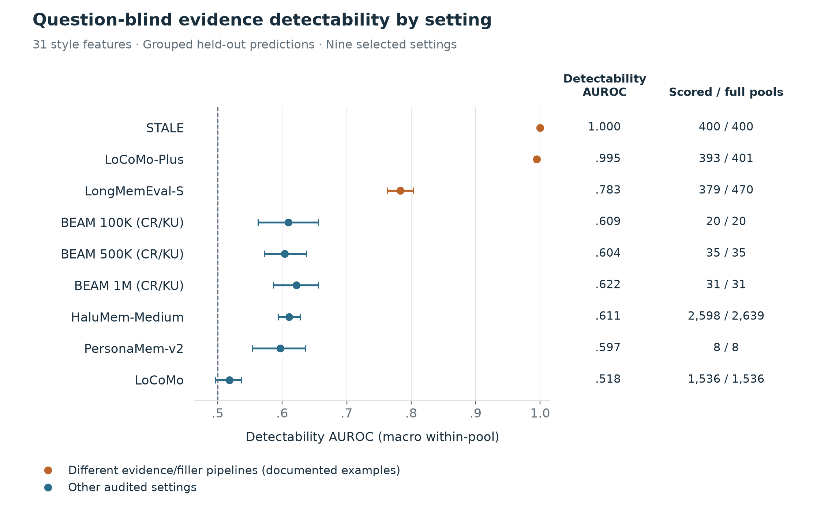
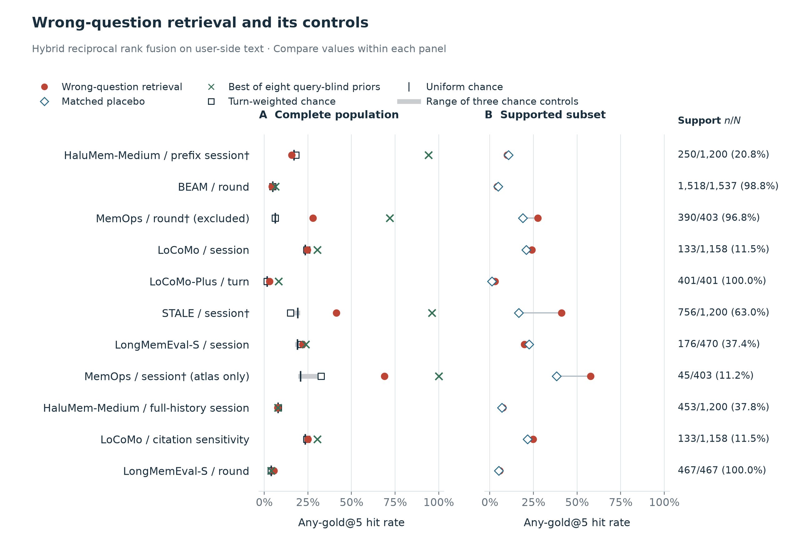
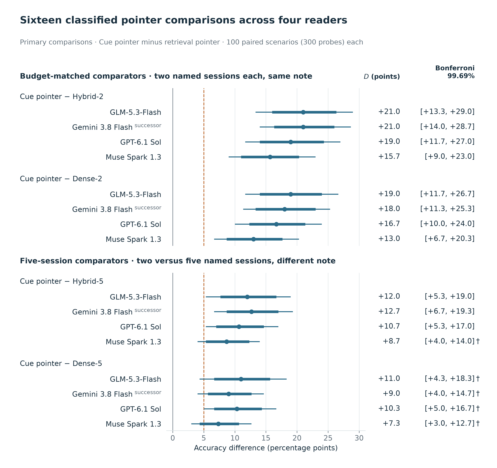
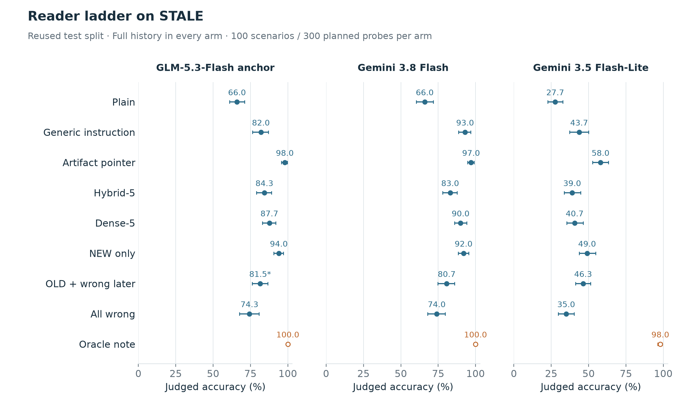
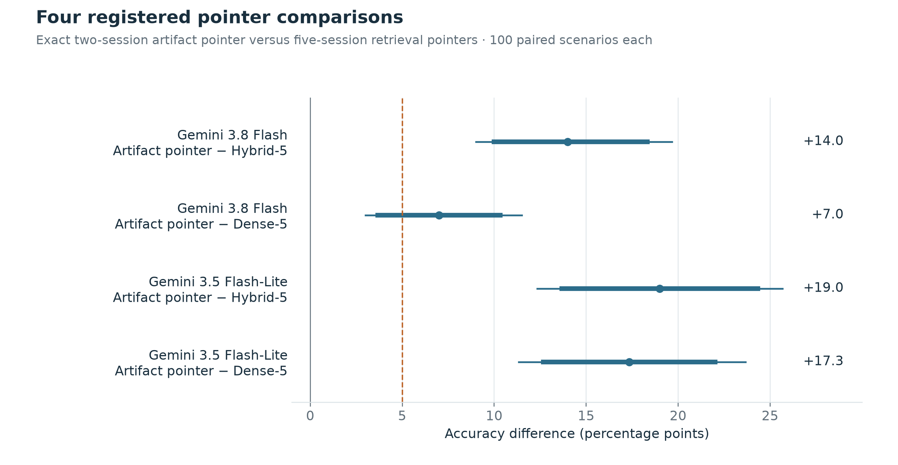
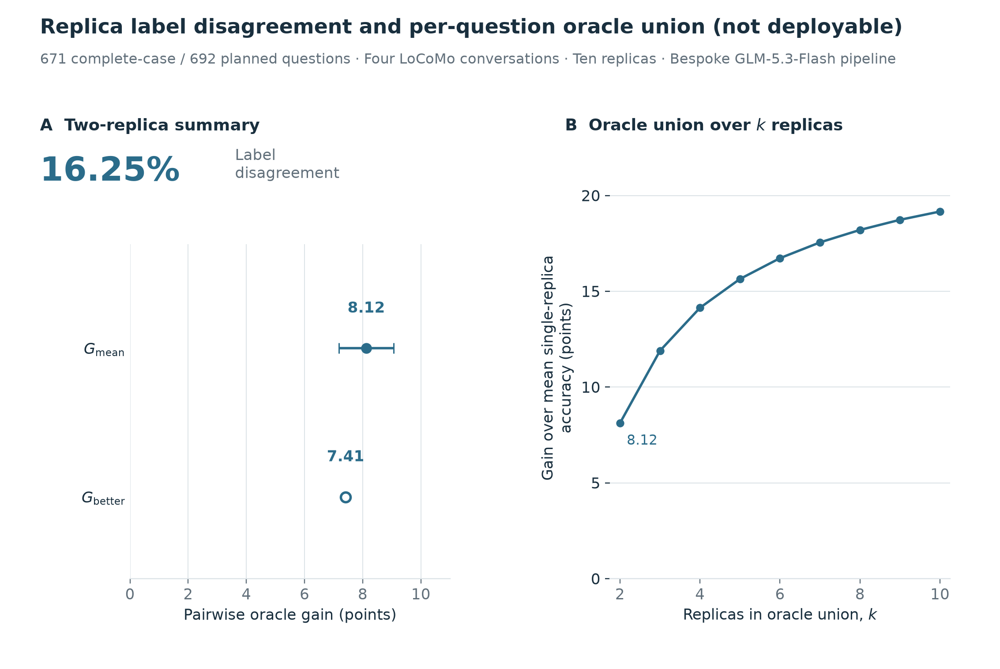

# Auditing Agent-Memory Benchmarks: Question-Blind Cues, Fair Nulls, and Replica Controls

Özgür Uğurlu

## Abstract

Agent-memory benchmarks score systems that remember long conversation histories. We audit whether such scores reflect how a benchmark was built, scored, or run rather than memory. First, evidence can be located without the question on STALE and LoCoMo-Plus: on STALE, the curly apostrophe (U+2019) marks all 800 evidence sessions and none of 19,200 distractors, so a one-character rule finds both answer-bearing (“gold”) sessions in all 400 scenarios. On BEAM, by contrast, retrieval with another item’s question is equivalent to chance once position, length, and turn count are accounted for (for our retriever and unit definitions). Second, the STALE cue is exploitable: a pointer built from it names the gold pair without the question and raises accuracy, as judged by a large language model (LLM), by 13–21 points over two-session retrieval pointers for four readers from four vendors (preregistered, on a test split whose outcomes had already been seen). This measures the value of exact retrieval, not a cue-specific effect, and those retrieval pointers trail an instruction that reveals what the rubric rewards. Third, native (unprompted) use of the cues is not shown. Removing typography and clock times together leaves one reader’s accuracy within ±5 points in a user-only layout and, in the official layout, a retrieval-augmented generation pipeline’s accuracy equivalent within ±3 points (+0.15 \[−1.29, +1.60\], Holm-adjusted); a mem0 test is inconclusive (+4.30 \[−0.21, +8.89\]). Replacing STALE’s distractors lowers retrieval recall by 12.6 points but adds harder negatives, and both end-to-end tests of replaced distractors are invalid because judge failures left one primary cell of each below the 98% completeness bar. Fourth, item labels are unstable: two rebuilds of one pipeline disagree on 16% of LLM-judged labels on average, while run-level accuracy varies by about 1 point, as averaging over 671 questions predicts; the author, as the sole and design-aware human grader, judged 10 of 15 sampled disagreements real. Finally, ForgetEval’s public score can reward wiping memory. None of this shows that published scores are inflated. We recommend question-blind scans, fair-null baselines, and replica reruns, and release the memaudit toolkit.

## 1. Introduction

Agent-memory benchmarks evaluate how well systems remember long conversation histories. Each score summarizes decisions about storage, retrieval, use, and forgetting. A single score can conceal evidence with a recognizable signature, instructions that reveal what the rubric rewards, or label differences that appear when an unchanged pipeline is rebuilt. We ask whether such scores can reflect how a benchmark was built or scored, or how one run of a pipeline happened to go, rather than memory, that is, whether they are valid measures of memory (Jacobs and Wallach 2021; Raji et al. 2021).

These scores rank memory systems and guide their design, so a construction artifact can propagate into both. The closest audits vary what a reader sees for a given question (Jiang et al. 2026; Si et al. 2026), study shortcuts in a small streaming environment (Huang 2026), or show that memory size can leak evidence-sufficiency labels (Mondal et al. 2026). We apply established partial-input and contrast-set controls (§2) to the annotated evidence of published long-history benchmarks, namely STALE (Chao et al. 2026), LoCoMo-Plus (Li et al. 2026), LongMemEval (Wu et al. 2025), BEAM (Tavakoli et al. 2026), HaluMem (Chen et al. 2025), PersonaMem-v2 (Jiang et al. 2025), LoCoMo (Maharana et al. 2024), and MemOps (Hao et al. 2026), against nulls that account for position, length, and turn count. We then ask whether readers, retrievers, and rebuilt memory pipelines are affected, and what the public score of ForgetEval, introduced by Yang (2026), rewards. The application of these controls, not the auditing principle, is new.

Four questions, each with its own estimand and intervention, organize the audit (Table 1). The first three form a chain: a construction cue can raise a score only if it can be detected without the question (Q1), if a system that used it would gain (Q2), and if ordinary systems do use it (Q3). Inflation, the last row of Table 1, ends that chain. It is not estimated here: the end-to-end tests designed to measure it are invalid (§6.3). Q4 asks whether the measurement itself, item labels and scoring rules, is stable enough to detect such effects.

**Table 1. Four questions, estimands, and findings.** The first three questions are successive conditions for inflation; Q4 asks whether the measurement is stable enough to detect it.

| Question | Estimand | Measured by | Status here |
|----|----|----|----|
| Q1. Where do question-blind evidence cues exist, and what do fair nulls show? (§4) | Detectability: can an auditor identify evidence without the question? | Detectability AUROC (area under the ROC curve; macro within-pool) of a question-blind classifier (§3.2); chance-corrected excess (CE) of wrong-question retrieval over fair nulls (§3.3) | Strong on STALE and LoCoMo-Plus, moderate on LongMemEval-S, weak elsewhere; permutation evidence for the selected settings is post hoc. Fair-null results differ across benchmarks: BEAM is equivalent to chance for our retriever and unit definitions, and our HaluMem adaptation creates a position shortcut. |
| Q2. How far is a cue exploitable? (§5) | Exploitability: does deliberately supplying the evidence–distractor distinction help a reader or retriever? | Accuracy gain of the artifact pointer over retrieval pointers (§3.4); recall gain of a constructed style ranker (§5.2) | On a reused test split, the artifact pointer, which supplies exact two-session retrieval without the question, beats two-session retrieval pointers by 13–21 points for four readers; this is the value of exact retrieval, not a cue-specific effect. A constructed ranker adds 34.00 recall points on STALE but loses 4.68 points on LongMemEval-S. |
| Q3. Do readers and memory systems rely on the cues natively? (§6) | Native reliance: do readers or memory systems benefit from the cues in ordinary use, with no pointer or constructed ranker? | Recall change under replaced distractors (§3.3, §6.1); accuracy change when cues are removed, for one reader (§6.2) and for two pipelines in the official layout (§6.4); end-to-end accuracy change under replaced distractors (§6.3) | Replacing STALE’s distractors lowers retrieval recall but also adds harder negatives. Removing clock and typography cues together leaves one plain reader’s accuracy practically equal within the registered ±5 points (reused split, user-only layout; clock times are also legitimate content); a benefit of up to about 4 points is not excluded. In the official layout, it leaves a hybrid retrieval-augmented generation (RAG) pipeline’s accuracy equivalent within ±3 points (+0.15 \[−1.29, +1.60\]), while the mem0 test is inconclusive (+4.30 \[−0.21, +8.89\]); both are conditional robustness evidence on a reused population. The end-to-end successor study’s two primary tests are final INVALID. |
| Q4. How stable are scores, and what do scoring rules reward? (§7) | Stability: how much do replica labels and accuracy vary, and how sensitive are scores to scoring rules? | Replica label disagreement and oracle gain (§3.5); null-memory-policy scores (§7.4) | Pairs of replicas disagree on 16.25% of labels from a large language model (LLM) judge on average, while run-level accuracy has an SD of 1.04 points, as averaging over 671 questions predicts; failed gates and the one-grader human check leave true correctness unresolved. Trivial memory policies (storing nothing, wiping memory) show that ForgetEval’s public score can reward wiping memory. |
| — | Inflation: is a published score higher than under an evaluation that preserves the intended task? | End-to-end accuracy with original against source-swap distractors (§6.3) | Not estimated. The end-to-end tests failed the completeness rule and yield no effect estimate (§6.3). Even if complete, source-swap distractors also add harder negatives, so the contrast could not separate inflation from harder interference. The pipeline de-cue study (§6.4) estimates a different contrast, RAW against DECUE, and does not measure inflation. |

We make five contributions, each building on established controls (§2):

- **(i) Q1, §4: a question-blind detectability audit and a fair-null atlas.** The audit covers nine settings from seven benchmark families (six if LoCoMo-Plus is merged with LoCoMo), and the wrong-question atlas covers seven benchmarks (adding MemOps; PersonaMem-v2 is not in the atlas). Cues are strong on STALE and LoCoMo-Plus, whereas on BEAM, under fair nulls, retrieval with another item’s question is equivalent to chance for one retriever stack and the registered unit definitions (a registered result).
- **(ii) Q2, §5: registered exploitability tests with four readers from four vendors.** On a reused test split, a pointer that names STALE’s gold pair without using the question beats two-session retrieval pointers in LLM-judged accuracy for each of the four readers. The cue therefore yields question-blind oracle retrieval on STALE, and the gain measures the value of exact retrieval, not a cue-specific effect. A three-sentence instruction that reveals what STALE’s rubric rewards closes about 53% of the plain-to-oracle gap for the original reader, and 51 of its 58 net extra passes are false-premise rejections (§5.1), so reader comparisons need instruction controls (§8).
- **(iii) Q3, §6: counterfactual-haystack, de-cue, and end-to-end tests of native reliance, none of which shows reliance.** Replacing STALE’s distractors lowers retrieval recall but also adds harder negatives; removing typography and clock times together leaves one reader’s accuracy practically equal in a user-only, non-official layout; and both end-to-end tests of replaced distractors, with RAG and a mem0 2.2.1 pipeline (mem0ai 2026), are final INVALID, with no inflation, null, or equivalence conclusion. In STALE’s official layout, a registered pipeline de-cue study finds a hybrid RAG pipeline’s accuracy equivalent within ±3 points with and without the two cues, while its mem0 test is inconclusive (§6.4).
- **(iv) Q4, §7: replica controls with a one-grader human check, and null-memory policies for a public scoring rule.** On four LoCoMo conversations, one bespoke pipeline, modeled on Mem0 (Chhikara et al. 2025) but not its code, was rebuilt ten times; pairs of these replicas disagree on 16% of LLM-judged labels on average, while run-level accuracy has an SD of about 1 point, as averaging over 671 questions predicts. One design-aware grader, the author, estimates that about two-thirds of the sampled label disagreements are real correctness differences (10 of 15 sampled pairs; bootstrap interval \[42.6, 91.2\] for the weighted share, which does not exclude a minority); this check uses one grader, not a panel, and does not supply ground truth. On ForgetEval, a wipe-plus-replacement policy passes 750 of 1,000 template cases against 350 for storing nothing, so the public score can reward wiping memory.
- **(v) The release statement: the open-source memaudit toolkit.** It implements the question-blind unit audit, wrong-question retrieval with fair-null baselines, null-memory policies for ForgetEval, and numeric replica replay. It runs no language model and is not a reproduction package: its default BM25 ranker does not reproduce the hybrid atlas, and its documented checks reproduce only selected numbers, such as the STALE and LoCoMo-Plus detectability scores.

## 2. Related work

**Agent-memory benchmarks and systems.** Long-term conversational memory is evaluated on multi-session dialogues, such as MSC (Xu et al. 2022) and LoCoMo (Maharana et al. 2024), and on long histories that combine evidence sessions with separately sourced filler, such as LongMemEval (Wu et al. 2025) and STALE (Chao et al. 2026). These benchmarks rank memory systems such as MemGPT (Packer et al. 2023), MemoryBank (Zhong et al. 2024), Mem0 (Chhikara et al. 2025), Zep (Rasmussen et al. 2025), and A-MEM (Xu et al. 2025); Zhang et al. (2025) survey the area. We audit benchmark families for which a question-blind adapter was tractable, not a representative sample (§9).

**Controls we build on.** Question-blind auditing is a partial-input baseline that follows hypothesis-only natural-language inference (Gururangan et al. 2018; Poliak et al. 2018), question-only and passage-only reading comprehension (Kaushik and Lipton 2018), and work on shortcut learning (Geirhos et al. 2020). A failing partial-input baseline does not show that a dataset is free of artifacts (Feng et al. 2019), single features whose label distribution departs from chance can be tested directly (Gardner et al. 2021), and single cues have inflated comprehension and inference scores before (Niven and Kao 2019; McCoy et al. 2019). Our counterfactual haystacks have precedents in adversarial filtering (Zellers et al. 2018; Le Bras et al. 2020), distractors (Jiang and Bansal 2019), contrast sets that change the gold label (Gardner et al. 2020), and paired evidence and hard-negative interventions (Du 2026; Zhang et al. 2026); our evaluation-time replacements also change how hard the negatives are. Work on judge reliability and agreement with humans (Zheng et al. 2023; Thakur et al. 2025; Bavaresco et al. 2025), order effects (Wang et al. 2024), judge panels (Verga et al. 2024), self-preference (Panickssery et al. 2024; Pombal et al. 2026), family preference (Awuni et al. 2026), and long-context calibration (Zhao et al. 2026) informs our judge gates. Studies of benchmark and training-run variance (Bouthillier et al. 2021; Madaan et al. 2024), error bars for clustered answers (Miller 2024), and routing oracles under stochastic decoding (Chen 2026) inform our replica analysis.

**Long-context readers.** Readers use evidence in long contexts unevenly by position (Liu et al. 2024), are distracted by irrelevant context (Shi et al. 2023), and are sensitive to prompt format (Sclar et al. 2024); needle-in-a-haystack tests overstate effective context use (Hsieh et al. 2024), especially when the needle repeats the question’s wording (Modarressi et al. 2025). These effects motivate our pointer controls, position priors, and layout caveats.

**Construction shortcuts and source preference.** Concurrent with our studies, Before Answering (Mondal et al. 2026) shows that memory size can leak evidence-sufficiency labels: a classifier that only counts paragraphs, without the question, detects unsafe memory with an AUROC of .979 on MuSiQue, and the proposed estimator, MemSafe, is query-conditioned. We apply the same question-blind logic to a different object, the annotated evidence units of published long-history agent-memory benchmarks, and add benchmark-specific fair nulls and downstream reader, retrieval, and replica controls. Huang (2026) studies distractor and type shortcuts under uninformative queries and unequal history access in a small streaming environment; we instead test the annotated evidence of existing benchmarks. Preferences for generated documents (Dai, Liu, et al. 2024; Dai, Zhou, et al. 2024), which have been linked to training data (Huang et al. 2026; Xion and Nejdl 2026), motivate our construction controls; we establish no mechanism for them here.

**Presentation, reconstruction, and visibility.** Several concurrent studies use query-conditioned controls. Presentation, Not Mechanism (Jiang et al. 2026) separates layout from deprecation with render-matched controls, and RENDER (Si et al. 2026) varies the reader-facing rendering of a fixed conversation. Neither evaluates STALE: the first uses issue histories, Wikipedia, and temporal streams, and the second LongMemEval and HotpotQA. Both find that presentation alone can move scores, which fits our caveat that the de-cue result holds for one layout only (§6.2). Madeleine (Shi 2026) separates query-encoder instructions from learned association and checks human-written triggers. RealCompanion (Behnam et al. 2026) uses no-context, random, recency, and broken-oracle controls with a probe-aware detector. RoutePrism (Xu et al. 2026) compares ingestion order with repeated-answer variation within a route, and Causal Memory Policy (Behnam and Wang 2026) intervenes on retrieval exposure. Our reader ladders differ in that the artifact pointer is derived from a construction cue without using the question and is matched to retrieval pointers in session count and note length, and our de-cue test edits STALE’s own rendering against a registered ±5-point margin. An engineering blog post distinguishes rebuilding from rescoring (Jones 2026), and a company blog post reports about 95.6% accuracy for its own memory pipeline on random 15% samples of STALE’s direct- and indirect-update questions (Liu 2026); our plain readers score 27.7–71.7% in the user-only full-history layout, a different setting. Item-level disagreement under stable aggregate accuracy is known as prediction churn or underspecification (Milani Fard et al. 2016; D’Amour et al. 2022) and, in LLM evaluation, as run-to-run nondeterminism (Song et al. 2025); our oracle union over $k$ replicas is the pass@$k$ coverage estimator (Chen et al. 2021; Brown et al. 2024) applied to judged labels. What the replica study adds is a same-input rebuild design for one memory pipeline, whose label disagreement is expressed as an oracle gain and checked by a human grader ([Appendix C.1](appendix.md)).

**Budgets and complete support.** Context budgets affect reranking (Sharma and Lall 2026) and complete-support evaluation (Wang et al. 2026). The released per-question labels of Sharma and Lall (2026) also supply the reference gain of §3.5. Our reader ladders (§3.4) name sessions within the STALE history that the reader already sees. Context Language Models let agents edit budgeted context files (Shao et al. 2026), a neighboring setting we do not evaluate.

**Registration and test reuse.** Our studies follow preregistration practice (Nosek et al. 2018; Miltenburg et al. 2021). Retesting on a split whose outcomes are known is adaptive reuse of a holdout, which weakens confirmatory inference (Dwork et al. 2015; Recht et al. 2019); we call such follow-ups conditional robustness checks. Low statistical power is a known problem in NLP evaluation (Card et al. 2020), so we report registered design power where it exists (§9). Benchmark-quality assessments (Bowman and Dahl 2021; Reuel et al. 2024) and work on leakage (Kapoor and Narayanan 2023) motivate the recommendations of §8.

## 3. Audit design

We answer Q1–Q4 with the following instruments. A question-blind classifier (§3.2) and wrong-question retrieval against fair nulls (§3.3) test Q1: if gold is found without its own question more often than position, length, and turn count explain, gold has a question-independent advantage. Reader ladders (§3.4) test Q2 by giving a reader the sessions that this advantage identifies. Counterfactual haystacks (§3.3), the de-cue and end-to-end tests (§6.2–§6.3), and the pipeline de-cue study (§6.4) test Q3 by removing or replacing the cue. Replica rebuilds and judge gates (§3.5), together with null-memory policies (§7.4), test Q4.

### 3.1. Studies, protocol, and conventions

Before testing, each registered study had a reviewed preregistration, a hash-locked protocol and code, and development gates. The post hoc statistics rounds had none of these, and the one-grader human check had a hash-pinned plan but no development gate; its reinstated human route was not registered (Appendix J.6). With each result we disclose post-lock changes and earlier exposure to outcomes; a hash lock fixes a protocol’s content, not which outcomes had already been seen ([Appendix I](appendix.md)). Table 2 maps the studies, whose populations differ; each judge validation covers only the packet it examined. We call every row of Table 2 a study; its name (audit, atlas, ladder, run, test, follow-up, regrade, or check) describes its design, not a different kind of object.

**Conventions.** *Registered* means fixed in a study’s preregistration before its test. *Post hoc* marks an analysis chosen after outcomes were seen; none changes a registered verdict. *Descriptive* and *exploratory* results support no registered verdict. Capitals mark registered verdict and status labels (POSITIVE, SMALL, EQUIVALENT, REVERSED, BELOW-SESOI, INCONCLUSIVE, PARTIAL, INVALID, FAILED PIPELINE, UNRESOLVED, COMPLETE, INCOMPLETE, UNPERFORMED, EXPLORATORY, PASS, ABOVE, and NO-COMMON-SUPPORT) and the arm names RAW, DECUE, NEW, and OLD; reader tiers are lowercase and quoted (“supported”, “practically equal”, “reversed”). *Final* marks a verdict or status that no remaining registered repair or retry can change. A study’s *binding judge* is the judge whose labels decide its registered verdicts. A *reused test split* is a test split whose outcomes had already been seen (registered texts quoted in the appendix call it “consumed”); a follow-up on it tests conditional robustness on that split, not fresh confirmation.

**Terms.** A *scenario* is one STALE test case: a 50-session history with three probe questions, or *probes* (§3.2). A *unit* is what a classifier or retriever scores: a session, round, or turn, depending on the benchmark. A *pool* is the candidate set of units within which a detectability AUROC is computed (for STALE, the sessions of one scenario), and a *haystack* is the set of units searched for one item. A *read* is one reader answer to one probe in one arm, and a *judge call* is one judge request that scores the three probes of one scenario and arm. A *gate* is a registered pass-or-fail check, such as judge validation, that must pass before a verdict is drawn; a *packet* is the sample of answers labeled for a judge-validation gate. A *reader ladder* compares one reader’s accuracy across arms (§3.4). A *test family* is a set of contrasts adjusted together for multiple testing; *model family* and *vendor* refer to models.

Answer-correctness labels come from LLM judges, except in the one-grader human check. *LLM adjudication* means that a further language model grades a sample of answers; its *adjudicator labels* serve as LLM reference labels, and agreement with them is not human validation. Square brackets give 95% intervals unless the text names another kind, such as a Holm-adjusted interval (Holm 1979) (atlas and counterfactual-haystack tests) or a Bonferroni per-contrast interval (ladders), whose level is given in percent.

**Verdict tiers.** Tiers differ by study. The three-reader ladder, the four-vendor ladder, the Gemini 3.8 Flash successor run, and the de-cue test classify an accuracy difference $D$ with the reader tiers of Table 2B. The ladders share one rule set with Holm adjustment and an open equivalence band, while the de-cue test, a single contrast, uses its 95% interval and a closed band. The atlas and counterfactual-haystack tiers are given in §3.3, and those of the pipeline de-cue study in §6.4 and Appendix L.1.

**Recomputations.** For seven studies, two separate recomputations from the saved outputs checked the registered numbers ([Appendix I.4](appendix.md)): the three-reader ladder, the four-vendor ladder, the Gemini 3.8 Flash successor run, the de-cue test, the wrong-question atlas, the second-judge study, and the extractor follow-up. The counterfactual-haystack study and the end-to-end successor study each received two further recomputations, and we adopted their documentary corrections. These are computational checks, not replication by another laboratory or label validation, and failed gates and missing data keep their status.

**Table 2. Study map (A) and registered reader tiers (B).** Q1–Q4 refer to Table 1, and every row of panel A is a study (§3.1). The last column of panel A gives the appendix sections and, in parentheses, the label the study carries there; S15 = S15a + S15b. The evidence audit (S10) also had an earlier reader branch that failed its judge gate. In panel B, $D$ is the scenario-mean paired accuracy difference in points (the artifact pointer minus its comparator in the ladders; RAW minus DECUE in the de-cue test), and the first tier that holds applies. Tiers apply only after the health and validation checks pass; otherwise a contrast is UNRESOLVED, INCOMPLETE, “not classified”, or “judge-limited” (Appendix B). Registered wordings vary (the de-cue test says “native reliance supported”).

| \(A\) Study | What it tests | Population | Status | Main text | Appendix (label) |
|----|----|----|----|----|----|
| The evidence audit | Q1: can evidence be found without the question? | Nine selected settings, seven benchmark families; detectability AUROC (macro within-pool) | Supervised and question-blind; permutation nulls post hoc | §3.2, §4.1 | A, H.1 (S10) |
| The wrong-question atlas | Q1: do wrong questions retrieve gold above fair nulls? | 11 item files from seven benchmarks; confirmatory rows HaluMem-Medium (1,200 items, 20 users) and BEAM (1,537 items, 86 conversations) | Registered; run on CPU only; other rows descriptive, exploratory, or reference | §3.3, §4.2 | E (S16) |
| The original ladder | Q2: the gold-pair pointer against other notes for a full-history reader | 100 STALE scenarios, 300 probes; 161 LoCoMo-Plus items from four hosts | Reader sees the full history; partly exposed by a pilot | §3.4, §5.1 | B.1, J.3 (S10b) |
| The three-reader ladder | Q2: the same contrasts with more readers | The original ladder’s test split, reused | Four primary and eight secondary contrasts | §3.4, §5.1 | B.2 (S10c) |
| The four-vendor ladder | Q2: adds hybrid-2 and dense-2 pointers matched to the artifact pointer in count and note, and readers from four vendors | The original ladder’s reused test split; four registered readers, one read per distinct request | Registered tiers for three readers; Gemini 3.8 Flash stopped, not classified; GLM-5.3-Flash secondary-judge results descriptive | §3.4, §5.1 | B.4 (S19) |
| The Gemini 3.8 Flash successor run | Q2: the four-vendor ladder’s Gemini 3.8 Flash reader, rerun | The four-vendor ladder’s reused split, arms, and judge; Gemini 3.8 Flash only, 2,375 fresh reads | Separately registered, with its own gate (passed); completes the four-vendor ladder’s test families; GLM-5.3-Flash secondary-judge results descriptive | §3.4, §5.1 | B.5 (S19b) |
| The counterfactual-haystack study: retrieval tests | Q2, Q3: does replacing or rewriting distractors change retrieval? | 400 STALE scenarios, 1,200 probes; 470 LongMemEval-S questions | Final: the STALE source-swap retrieval test POSITIVE; the STALE style-rewrite and LongMemEval-S source-swap tests exploratory (manipulation check PARTIAL); style content check UNPERFORMED | §3.3, §5.2, §6.1 | D.1–D.3 (S15a) |
| The de-cue test | Q3: does removing typography and clock cues change a plain reader’s accuracy? | The original ladder’s reused test split; one reader, two draws per arm | Registered tier “practically equal” | §6.2 | B.3 (S18) |
| The counterfactual-haystack study’s planned end-to-end stage | Q3: the end-to-end effect of source-swap distractors | Stopped before any end-to-end call | Not computed: stopped by its registered budget-forecast rule | §6.3 | D.4 (S15b) |
| The end-to-end successor study | Q3: the same end-to-end comparison, registered separately | Test: 189 STALE scenarios, 100 of them for the memory pipeline | The retrieval-augmented generation (RAG) and mem0 end-to-end tests final INVALID (completeness rule); required auxiliary check incomplete | §6.3 | D.5–D.6, H.2 (S15c) |
| The pipeline de-cue study | Q3: do a hybrid RAG pipeline and a mem0 2.2.1 pipeline score differently with and without STALE’s typography and clock-time cues, in the official layout? | 398 STALE scenarios, 150 of them for mem0, all reused; three reads per probe and condition | Registered; gate passed; RAG test EQUIVALENT (±3), mem0 test INCONCLUSIVE (±5) | §6.4 | L (S20) |
| The replica study | Q4: label and accuracy variation across ten replicas of one pipeline | Four LoCoMo conversations; 692 planned questions, 680 with all ten replica labels; complete-case sets of 671 (oracle gain) and 675 (variance model) | Bespoke GLM-5.3-Flash pipeline, not upstream Mem0 | §3.5, §7.1 | C.1, J.4 (S11) |
| The crossed-family follow-up | Q4: replica gains with crossed extractor and judge model families | Development stage only | Stopped at its development gate; no test ran | §7.2 | C.2 (S11b) |
| The extractor follow-up | Q4: replica gains with extractors from two model families | Seven reused conversations | UNRESOLVED: its judge failed validation | §7.2 | C.2 (S11c) |
| The second-judge study | Q2, Q4: verdicts under a judge from another model family | Part A: 3,150 answers from the extractor follow-up; Part B: the three-reader ladder’s 87-item validation packet; pointer-contrast part: that ladder’s 900 primary pointer-arm judge calls | Post hoc sensitivity analysis on reused answers; Part A UNRESOLVED (judge failed validation); pointer contrasts supported under the second judge | §5.1, §7.2 | C.3, C.4 (S17; S17-B2 = pointer-contrast part) |
| The LLM regrade | Q4: agreement of other LLM graders with the binding judges | 100 selected items from the original ladder and the replica study | Three LLM adjudicators; not human validation | §7.3 | F (LLM regrade; claim C2 = ladder part, claim C3 = replica part) |
| The one-grader human check | Q2, Q4: agreement of one human grader with the judges | The same 100 items | One design-aware grader (the author); not a panel or ground truth | §5.1, §7.1, §7.3 | J (human regrade) |
| The null-policy study | Q4: what does a public forgetting score reward? | ForgetEval: 385 adversarial and 1,000 template cases; LoCoMo harness options on 692 test questions | Registered; trivial policies earn public passes; the strict keep-set coverage check failed (74.3%, below 80%) | §7.4 | G.1 (S1) |
| The forgetting-closure study | Q4: can a linked-information scan cut collateral loss under a forgetting objective? | 638 nonempty test forget requests from 150 authors | Registered practical target not supported | §7.4 | G.2 (S14) |
| Post hoc statistics (three rounds) | Descriptive follow-ups on saved outputs | Saved outputs of the evidence audit, the three-reader ladder, the replica study and its two follow-ups, the wrong-question atlas, the second-judge study (pointer-contrast part), and the regrade outputs | Descriptive; no verdict changes; third-round nulls checked from saved values | §4.1, §4.2, §5.1, §7.1, §7.3 | H.1, I.3 (post hoc rounds 1–3) |

| \(B\) Reader tier | Three-reader ladder (S10c) | Four-vendor ladder and successor run (S19, S19b) | De-cue test (S18) |
|----|----|----|----|
| “supported” | Holm-adjusted $p < .05$, adjusted lower bound $> 0$, and $D \geq 5$ | As in S10c | $p < .05$, lower bound $> 0$, and $D \geq 5$ |
| “supported, at least +5” | “Supported” with adjusted lower bound $> 5$ | As in S10c | — |
| “small positive” | — | — | $p < .05$, lower bound $> 0$, and $0 < D < 5$ |
| “reversed” | Adjusted upper bound $< 0$ | As in S10c | $p < .05$, upper bound $< 0$, and $D < 0$ |
| “practically equal” | Adjusted interval inside the open band $(-5, +5)$ | As in S10c | 95% interval inside the closed band $[-5, +5]$ |
| “inconclusive” | Otherwise | Otherwise | Otherwise |
| Interval | Bonferroni per-contrast, 98.75% (= 1 − .05/4) | Bonferroni per-contrast, 99.69% (= 1 − .05/16) | 95% scenario bootstrap |
| Test family | Holm over four primary contrasts | Holm over 16 primary contrasts | One contrast, no adjustment |

### 3.2. Audited benchmarks and question-blind detectability

The evidence audit asks whether a classifier that never sees the question can tell evidence units from distractors. It covers nine selected settings: STALE (Chao et al. 2026), LoCoMo-Plus (Li et al. 2026), LongMemEval-S (Wu et al. 2025), three BEAM scales (Tavakoli et al. 2026), HaluMem-Medium (Chen et al. 2025), a cached PersonaMem-v2 subset (Jiang et al. 2025), and LoCoMo (Maharana et al. 2024). These form seven benchmark families: the three BEAM scales count once, and the separately published LoCoMo-Plus counts apart from LoCoMo (six families if merged). The BEAM rows label evidence only for contradiction-resolution and knowledge-update (CR/KU) tasks. The wrong-question atlas (§3.3) covers seven benchmarks: these minus PersonaMem-v2, plus MemOps (Hao et al. 2026).

Table 3 describes how each benchmark family produced its evidence and its distractors or filler, and which cue the audit found. Three settings combine a benchmark-authored evidence pipeline with distractors or filler from another source: STALE (sessions sampled from LongMemEval), LoCoMo-Plus (cue dialogues inserted into LoCoMo conversations), and LongMemEval-S (public chat as part of its filler). These are the documented different pipelines marked in Figure 1. The pattern is correlational, not a necessary condition: BEAM’s instruction-following evidence, whose labels this audit does not use, comes from the same generator as its filler and is still strongly detectable (detectability AUROC .936–.971).

**Table 3. Audited benchmarks.** One row per benchmark family: the unit we score, how the benchmark’s evidence and its distractors or filler were produced (as its paper describes them), the cue our audit found, and the paper section. † marks the three documented different evidence and filler pipelines of Figure 1. AUROCs are detectability AUROCs (macro within-pool; Figure 1, Appendix Table A1), except for MemOps, which is not in the evidence audit and has only the atlas’s single-feature AUROC (within-haystack).

| Benchmark (unit) | Evidence | Distractors or filler | Cue found; AUROC | Source |
|----|----|----|----|----|
| STALE† (session) | Two LLM-generated, human-edited sessions per scenario: an old fact and a newer, implicitly conflicting one | 48 sessions per scenario sampled from LongMemEval and filtered (a third match LongMemEval-S verbatim; the rest could not be checked) | U+2019 in all 800 evidence sessions and in no distractor; the gold pair shares its clock time in 395 of 400 scenarios; 1.000 | Chao et al. (2026), §3.4 |
| LoCoMo-Plus† (turn) | LLM-generated cue dialogues, manually verified, inserted into LoCoMo conversations | The host LoCoMo conversations | No exclamation mark in any of 758 cue turns, against 72.0% of host turns; .995 | Li et al. (2026), §4 |
| LongMemEval-S† (session) | Self-chat sessions simulated by an LLM from human-written evidence statements, then human-edited | Simulated sessions and public user–assistant chat (ShareGPT; UltraChat (Ding et al. 2023)) | Formatting and length; .947 against public-chat filler and .532 against simulated filler; .783 overall | Wu et al. (2025), §3.2 |
| BEAM, three scales (user turn) | Automatically generated user–assistant conversations, built from conversation plans; CR/KU labels only | The rest of the same conversation | Weak (digit rate, straight apostrophe); .604–.622 | Tavakoli et al. (2026), §2.2 |
| HaluMem-Medium (prefix session) | Six-stage generation from PersonaHub user seeds (Ge et al. 2024) to sessions, with injected distractor memories | The user’s other generated sessions | Position in our prefix pools (position alone .838); .611 | Chen et al. (2025), §4 |
| PersonaMem-v2 (user message) | LLM-generated preference conversations of two to six turns | The persona’s other conversations, up to 32,000 tokens | Weak (second-person rate); .597 | Jiang et al. (2025), §2.2 |
| LoCoMo (session) | Conversations between LLM agents grounded in personas and event graphs, then human-edited | The other sessions of the same conversation | None (negative control); .518 | Maharana et al. (2024), §3 |
| MemOps (round; atlas only) | Generated evidence conversations of three eight-turn segments | Unrelated UltraChat conversations, plus context-level distractors derived from the gold trace | Longer user turns; single-feature AUROC (within-haystack) .976 for user characters | Hao et al. (2026), §3.2 |

For each setting, an adapter defines units, pools, evidence labels, and groups. The gradient-boosted classifier used 31 style features of each unit’s text and role, and it excluded questions, evidence ids, and timestamps. It was evaluated with five-fold grouped cross-validation and scored by detectability AUROC (macro within-pool; Figure 1 and Appendix A.1). Appendix K.2 specifies the learner, its settings, the cross-validation groups and seed, and the 31 features. The released toolkit implements this audit; its documented checks reproduce the STALE and LoCoMo-Plus scores of Figure 1 from the public benchmark files but do not cover the other seven settings (release statement). The registration treats a detectability AUROC below .55 as negligible; this is an interpretation threshold, not a calibrated significance level, and the only permutation null is post hoc (§4.1).

A test-duplicate exclusion removed held-out units whose hash of raw role and text also occurs in training. On STALE it excluded 10,540 of 20,000 rows, so filtered and full-pool scores describe different populations.

**The STALE task.** STALE has 400 scenarios, 200 of each of two types, and each scenario has a 50-session history between a user and an assistant (Chao et al. 2026). Two generated sessions form the *gold pair*. The older session (OLD), always among the first 15, supports a fact about the user; the newer session (NEW), always among sessions 31–40, implies a change that invalidates the fact without saying so. In *co-referential* scenarios both sessions concern the same attribute; in *propagated* scenarios NEW changes a related attribute, and the old fact fails as a consequence. The other 48 sessions are distractors sampled from LongMemEval and filtered so that none can update the fact. Each scenario has three probes. *State Resolution* (SR) asks directly about the old fact. *Premise Resistance* (PR) asks a question that presupposes the outdated fact, a false premise: the official rubric passes an answer only if it detects the premise or acknowledges the new state, so a pass on PR is a false-premise rejection. *Implicit Policy Adaptation* (IPA) asks for help whose appropriate answer depends on the updated fact, without mentioning either session. An LLM judge grades each answer against the scenario’s outdated and updated states. Our reader ladders and the de-cue test use a fixed test split of 100 scenarios (50 of each type), the next 100 after 40 development scenarios in a hash order of scenario ids (Appendix K.1).

### 3.3. Counterfactual haystacks and wrong-question retrieval

The counterfactual-haystack study changed the distractors while holding questions, evidence, positions, and session counts fixed. On STALE, *source-swap distractors* are evidence-type sessions from other scenarios; on LongMemEval-S, they are simulated sessions that are never evidence. Each test compares the original haystack with its counterfactual. Differences are original minus counterfactual, in points, so positive values mean lower recall or accuracy under the counterfactual; either swap can also change difficulty. The primary test family has three tests of hybrid all-gold@5 (every gold unit in the top five): the STALE source-swap retrieval test, the STALE style-rewrite test, and the LongMemEval-S source-swap test. The style-rewrite test keeps STALE’s distractors but applies *style rewrites* to them. A test is POSITIVE if its Holm-adjusted lower bound is above 0 and its estimate is at least +5 points. A counterfactual is PARTIAL, which makes its tests exploratory, if its manipulation check fails: the evidence-audit classifier still separates evidence from the new distractors (detectability AUROC above .60, or a 95% upper bound above .65). For style rewrites, failed content checks also make it PARTIAL (Appendix D.1). A secondary family measures *same-type wrong-question retrieval*: retrieval when the retriever receives another item’s question (a *wrong question*), here ten hash-chosen questions of the same probe dimension (on LongMemEval-S, the same question type).

The wrong-question atlas extends wrong-question retrieval to other benchmarks and compares it with fair nulls: baselines that account for advantages a unit has under any query, such as its turn count, length, or position. Query-independent advantages of this kind, such as length effects and document priors, are long recognized in retrieval (Singhal et al. 1996; Kraaij et al. 2002; Craswell et al. 2005); our nulls adapt them to wrong-question hits on memory units. For each item, a fixed hybrid retriever ranks the item’s units on user-side text once for each of ten wrong questions drawn from a different group (*atlas wrong-question retrieval*). A unit’s score is the maximum over its turns, and the outcome is whether any gold unit reaches the top five (any-gold@5). Because max-pooling favors units with more turns under any query, the primary null is turn-weighted chance: Plackett–Luce sampling (Luce 1959; Plackett 1975) with each unit weighted by its nonempty turns. The effect is the *chance-corrected excess* (CE), the item mean of $(h_i - c_i)/(1 - c_i)$, where $h_i$ is item $i$’s wrong-question hit rate and $c_i$ its null rate. A CE above 0 means that wrong questions retrieve gold more often than turn count, length, and position explain. Because the two procedures draw wrong questions differently, STALE’s same-type rate (42.08%; §6.1) differs from its atlas rate (41.40%; Table 4).

A secondary estimand replaces the null with matched placebos: 20 placebo gold sets drawn from non-gold units in the same length, turn-count, and position cells. It needs common support on at least 80% of items. Rows of the confirmatory and placebo families receive tiers at their Holm-adjusted intervals: POSITIVE if the lower bound is above 0 and CE is at least .05; REVERSED if the upper bound is below 0; and EQUIVALENT if the interval lies strictly inside ±.03 CE, the interval-inclusion form of the two one-sided tests (TOST) procedure (Schuirmann 1987; Lakens 2017). Appendix E.1 gives the remaining tiers. A benchmark shows a construction cue in the atlas’s sense only if its placebo estimand is POSITIVE. The other rows carry descriptive 95% intervals and no tier; among them, the STALE and LongMemEval-S reference rows are displayed but not tested, beside a legacy run that reproduces the counterfactual-haystack study’s rates. A *cue-dominance check* labels a row cue-dominated if any registered question-blind feature separates gold with a single-feature AUROC (within-haystack) of at least .90. These features are length, turns, position, and non-ASCII or typographic marks; in a cue-dominated row only the placebo estimand may be interpreted.

The confirmatory family is HaluMem-Medium and BEAM. MemOps-round (Hao et al. 2026) joins it only if it passes an *admission rule*: each of three features (user characters, nonempty turn count, and position) must have a single-feature AUROC (within-haystack) below .90. The run was frozen before any retrieval.

### 3.4. Reader ladders

The reader ladders compare a reader’s accuracy across arms that differ in the note placed before the question. Every arm shares the official STALE system prompt and the same user-only rendering of the 50-session history, in the studies’ non-official user-message layout. The *plain* arm adds no note, and the *generic instruction* adds a three-sentence instruction aligned with the rubric: facts can change, rely on the latest, and check the question’s premise (verbatim in Appendix K.5).

Retrieval pointers name the sessions that a retriever returns for the question: five in *hybrid-5* and *dense-5* and, in the four-vendor ladder only, two in *hybrid-2* and *dense-2*. The hybrid retriever fuses BM25 (Robertson and Zaragoza 2009) with a configured bge-small-en-v1.5 dense encoder (Xiao et al. 2024) by reciprocal rank fusion (RRF) (Cormack et al. 2009); Appendix K.3 gives the retrieval settings. The *artifact pointer* (the gold-pair pointer of Tables 1 and 2) names the sessions that contain the character U+2019, which on STALE are exactly the two gold sessions in 100 of 100 test scenarios; it therefore supplies exact two-session retrieval without using the question. The shared rendering normalizes STALE’s typography and keeps dates but not clock times in session headers (Appendix K.5 gives the normalizer’s mapping). The history the reader sees therefore lacks the U+2019 marks from which the pointer is built; §6.2 restores both cues. The *oracle note* is privileged: it labels the earlier statement outdated and carries the gold text, not only its location.

All pointer arms share one session-list and staleness template, distinct from the generic instruction; only the listed sessions change. Three control arms of the three-reader ladder use the same template. *NEW only* names only the newer gold session. *OLD + wrong later* names the older gold session and the non-gold session after it that lies closest to the newer gold session. *All wrong* names that non-gold session and the non-gold session closest to the older gold session, so it names no gold session. The four-vendor ladder adds a secondary *gold-pair-plus-three* arm, which names the gold pair and three hash-chosen non-gold sessions; the end-to-end successor study gives its readers such a five-session context and calls it “Oracle-5”. The appendix keeps the registered ids, for example `ptr_regex` for the artifact pointer, `ptr_hyb5` for hybrid-5, and `ptr_art5` for gold-pair-plus-three.

The pointer notes are 35, 46, and 79 tokens long for one, two, and five sessions. The original and three-reader ladders compare the two-session artifact pointer with five-session retrieval pointers, so in those ladders four factors vary together: the number of named sessions, the note’s token budget, which sessions are named, and how well the template’s staleness instruction fits them. The four-vendor ladder’s two-session pointers share the artifact pointer’s 46-token note, matching its count and note length but not the number of returned evidence tokens or complete support.

The original ladder used GLM-5.3-Flash as reader and binding judge. The judge was selected after development validation, and intervals were clustered by scenario. The three-reader ladder estimated scenario-mean paired effects with registered permutation tests; its analysis code changed after the lock (Appendices B.2 and I.2). The four-vendor ladder kept that estimator and those tiers, with Holm adjustment over 16 primary contrasts (Table 2B).

The four-vendor ladder used four readers from four vendors: Z.AI’s GLM-5.3-Flash (Z.AI 2026), Google DeepMind’s Gemini 3.8 Flash (Google DeepMind 2026b), OpenAI’s GPT-6.1 Sol (OpenAI 2026), and Muse Spark 1.3, a Meta Superintelligence Labs model served through the Meta Model API (Meta 2026). Muse Spark ran in Meta’s standard tier, whose prompts and completions are excluded from model training; the registration refused the discounted “contributor” variants. Each reader ran at temperature 1.0 and at its vendor’s “high” reasoning-effort setting; these vendor labels do not denote comparable reasoning levels. The binding judge was GPT-6.1 Sol at medium reasoning effort, and it also judged its own vendor’s reader. Its validation gate used a fresh 72-item packet, labeled after all reads by a fresh Claude Opus 5.5 instance (Anthropic 2026a) that saw no arm, reader, or outcome. The Gemini 3.8 Flash successor run, a separate registration, reran Gemini 3.8 Flash alone (§5.1). The API ids are `glm-53-flash` (GLM-5.3-Flash), `gemini-3.8-flash` (Gemini 3.8 Flash), `gemini-3.5-flash-lite` (Gemini 3.5 Flash-Lite), `gpt-6.1-sol` (GPT-6.1 Sol), `muse-spark-1.3` (Muse Spark 1.3), `claude-sonnet-5-5` (Claude Sonnet 5.5), and `claude-opus-5-5` (Claude Opus 5.5); Appendix K.7 gives every model’s settings.

### 3.5. Replica oracle and judge validation

A *replica* is one rebuild of the memory store from the same inputs; the replica study built ten per conversation, and the variance component due to rebuilding is the store (extraction) variance. We express the disagreement between replicas as the gain of a per-question oracle, so that rebuild noise can be set beside reported improvements. For aligned binary labels from two replicas with accuracies $a$ and $b$, let $d$ be their *label disagreement*, the percentage of questions on which their labels differ; on such a question the two replicas form a *disagreeing pair* (a *flip*). The per-question oracle union then gains $G_{\mathrm{mean}} = d/2$ points over the pair mean and $G_{\mathrm{better}} = d/2 - \lvert a - b \rvert/2$ points over the better replica. These identities hold whenever both replicas are scored on the same questions with the same weights; they do not require independent replicas. In the replica study, the uncertainty estimate combined question resampling with a store jackknife; it is conditional on the observed conversations, and the 45 replica pairs share replicas.

For scale, the per-question union of two memory systems of Sharma and Lall (2026), one that selects raw turns and one that retrieves extracted facts, beats the better of them by 8.9 points on 778 LoCoMo questions. We recomputed this gain from their released labels; their paper reports a noninferiority comparison of the two systems (77.0% against 77.5%), not this gain. The replica study registered half of it, 4.45 points, as a threshold, and the extractor follow-up tested against the same threshold (§7.2). We use the 8.9 points only as a reference scale, not as a same-population comparator or an estimate of their noise.

The original replica results used LLM labels, so the follow-ups carried a binding judge-validation gate. The gate uses a registered packet of at least 60 labeled or determinate items. On it, the judge must reach agreement of at least .80 and Cohen’s $\kappa$ (Cohen 1960) of at least .70 against the adjudicator labels. The replica gates use *design-weighted* agreement and $\kappa$, which reweight the packet by its sampling weights to its frame, the full answer set it was drawn from; the gates of the three-reader ladder, the four-vendor ladder, and the Gemini 3.8 Flash successor run are unweighted (Appendix I.3). A failed gate makes the dependent cells UNRESOLVED, whatever their statistics say. Near the thresholds, the gate is a noisy classifier of judge quality: in a post hoc simulation that takes the observed agreement tables as true, a judge like the extractor follow-up’s passes a gate-sized packet in about 43–49% of draws (Appendix I.3). A failed gate therefore withholds a verdict; it does not show that the judge is unreliable (§7.3).

## 4. Evidence can be located without the question in some settings

We first ask where evidence can be located without the question (§4.1) and whether wrong questions retrieve gold above fair-null baselines (§4.2).

### 4.1. Style features separate evidence on STALE and LoCoMo-Plus, less clearly elsewhere

On STALE, a single character locates the evidence exactly. The character U+2019 appears in all 800 evidence sessions and in none of the 19,200 distractors. A rule based on this character recovers both annotated sessions in 400 of 400 scenarios, or in 399 when it scans only user turns. On LoCoMo-Plus, a simple marker also separates the evidence: none of the 758 cue turns (LoCoMo-Plus’s evidence turns) contains an exclamation mark, against 72.0% of host turns. These are corpus properties; they do not show that the markers were planted deliberately.

The evidence audit applied the question-blind style classifier of §3.2 to nine selected settings, each with its own adapter (Figure 1). Detectability AUROC (macro within-pool) is high on STALE and LoCoMo-Plus (1.000 and .995), moderate on LongMemEval-S, and weaker elsewhere; LoCoMo’s interval includes .5. In the audit’s registered classes (below .55 negligible, .55–.65 weak, .65–.90 strong, at least .90 saturated), STALE and LoCoMo-Plus are saturated, LongMemEval-S is strong, and the three BEAM scales, HaluMem-Medium, and PersonaMem-v2 are weak. LoCoMo, at .518, is the only setting below the registered .55 threshold. LongMemEval-S scores .783 on 379 duplicate-filtered pools and .752 on all 470 pools in an earlier fit. Earlier LongMemEval-S fits conditioned on filler source gave .947 against public-chat filler (ShareGPT and UltraChat (Ding et al. 2023)) and .532 against simulated filler.

Separating evidence from distractors is not the same as recovering it. On LoCoMo-Plus, the classifier ranks an evidence turn first in only 52.4% of scored pools and places at least one in its top five in 91.9%. The question-driven retriever of the original ladder, applied to its 161 LoCoMo-Plus test items, places at least one evidence turn in its top five for only six of them.

In post hoc permutation tests, all nine classifiers beat their nulls after Holm correction at .05 (Appendix H.1). Each classifier was refitted on 1,000 within-pool label permutations; eight settings reach the resolution floor of p = 1/1,001 = .000999, which is not a confidence bound. LoCoMo, at a detectability AUROC of .518, is barely above chance; it is the only setting in which some permuted refits reach the observed AUROC (10 of 1,000, p = .011). It passes only as the last Holm step and would fail a Bonferroni cut (.0056). Holm does not correct for our outcome-informed choice of settings and classifier, and a small p does not identify the mechanism.

In post hoc checks, simpler features also separate STALE’s evidence: the curly-apostrophe count alone gives a single-feature AUROC of 1.000, and length alone gives .947. A refit without typography and punctuation features gives a detectability AUROC of about .999, but its predictions were not saved and no separate refit repeated it. The pattern fits redundant marking, yet the remaining features can still carry punctuation effects, so the refit is not a causal test of typography.

Weak style scores do not mean that evidence cannot be located (cf. Feng et al. 2019). In a post hoc check, position alone (which the style classifier omits) scores a higher AUROC than the classifier on BEAM and HaluMem; on HaluMem it reaches .838 against the classifier’s .611. Detectability by itself shows neither exploitation nor score inflation.

<figure>

<figcaption aria-hidden="true">Figure 1: question-blind evidence detectability</figcaption>
</figure>

**Figure 1. Question-blind evidence detectability by setting.** Question-blind style features separate evidence almost perfectly on STALE and LoCoMo-Plus, moderately on LongMemEval-S, and weakly elsewhere. Points give the detectability AUROC (macro within-pool) of supervised 31-feature unit-style classifiers, scored on held-out groups after the test-duplicate exclusion, in nine selected settings from seven benchmark families (six if LoCoMo-Plus is merged with LoCoMo). Bars are saved 95% group-bootstrap intervals (2,000 draws); they condition on the saved predictions and exclude fitted-model uncertainty. The dashed line marks chance (.5). No permutation band is drawn; §4.1 reports the post hoc permutation nulls. Colors mark the three settings with documented different evidence and filler pipelines (Table 3); they describe source construction and do not establish its causal effect. CR/KU: contradiction-resolution and knowledge-update evidence labels. The pool column gives scored and full pools: LongMemEval-S uses 379 of 470 pools, and PersonaMem-v2 a cached eight-pool subset. For BEAM 1M the full count is the preregistered loaded population (31 pools); the audit report’s pre-exclusion count is 35 (Appendix Table A1).

### 4.2. Under fair nulls, wrong-question retrieval is at chance on BEAM; STALE and our HaluMem adaptation are cue-dominated

Given another item’s question, a retriever finds BEAM’s gold evidence at a rate equivalent to chance under fair nulls, while STALE and our HaluMem adaptation are cue-dominated (Figure 2, Table 4). These results come from atlas wrong-question retrieval (§3.3), in which ten wrong questions from a different group rank each item’s units, and they hold for one retriever stack and the registered unit definitions. The atlas covers seven benchmarks: those of §4.1 except PersonaMem-v2, plus MemOps. BEAM and HaluMem-Medium form the confirmatory test family and carry Holm-adjusted intervals; the other rows carry descriptive 95% intervals (Appendix E.1). Table 4 also gives the best query-blind prior, a ranking by one feature such as length or position.

**BEAM (confirmatory): EQUIVALENT on both estimands.** Wrong questions retrieve gold at 4.44%, against 4.84% under turn-weighted chance (both item-weighted rates). The chance-corrected excess is CE = −.004, Holm-adjusted interval \[−.014, .006\]. Against matched placebos, with common support on 98.8% of items, CE = −.007, Holm-adjusted interval \[−.020, .006\]. Both intervals therefore exclude any query-independent advantage larger than the ±.03 CE margin, about ±2.9 points at BEAM’s item-weighted turn-weighted null of 4.84% (.03 × 95.16 = 2.85; a post hoc, illustrative translation). The EQUIVALENT verdict does not certify that BEAM is free of other cues or that its scores are valid.

**Fair nulls change interpretations.** On LongMemEval-S, atlas wrong-question retrieval (22.04%) exceeds uniform chance (18.93%) by 3.1 points. Turn-weighted chance (21.06%) accounts for about two-thirds of that gap, leaving CE = .011 \[−.017, .041\] (Table 4; Appendix E.4).

**HaluMem-Medium: not interpreted, because our own adaptation created a shortcut.** Its wrong-question rate is below the turn-weighted null, and the row’s tier is REVERSED. Yet position alone separates gold with a single-feature AUROC (within-haystack) of .968 on our prefix haystacks (compare the macro within-pool .838 of position on the evidence-audit pools, §4.1), which makes the row cue-dominated (§3.3). The shortcut comes from our registered prefix haystacks, which end at the later of the question’s session and the latest evidence session. Gold is the last unit in 72.3% of sampled items.

HaluMem-Medium’s placebo estimand also lacks common support, with only 20.8% of items supported. A descriptive sensitivity analysis used the full histories of the same items instead. There the row is not cue-dominated, the best prior falls to uniform chance, and CE is near zero (Table 4).

Among the other rows, LoCoMo and LongMemEval-S, both exploratory, sit near the turn-weighted null with intervals that include 0, and LoCoMo-Plus is slightly above its null. The MemOps round row failed its admission rule, with a single-feature AUROC of .976 for user characters, so it is only descriptive. Its matched-placebo CE is .099 \[.063, .134\], but that interval may be too narrow, because some host conversations are reused across clusters. STALE is cue-dominated, with a single-feature AUROC of 1.000 for typographic marks; on the 63.0% of its items with placebo support, wrong-question retrieval reaches 41.2%, against 16.6% for matched placebos ([Appendix E.4](appendix.md)).

A strong prior shows that gold differs on a query-blind feature, but not that a query-based retriever’s wrong-question hits come from that feature. The best of eight registered single-feature priors ranks units with the fewest turns first on STALE, the last unit first on our HaluMem prefix haystacks, and the longest first on MemOps sessions (the HaluMem and MemOps patterns were known before registration; Appendices E.5 and I.2). Each best prior is a selected maximum and therefore descriptive; a post hoc check compares it with its selection null ([Appendix E.4](appendix.md)).

The atlas establishes no native reliance on cues, no inflation of published scores, and no cue mechanism. Only the two confirmatory rows can carry placebo tiers, and neither is positive: BEAM’s is EQUIVALENT, and HaluMem-Medium’s lacks common support. Descriptively, the MemOps round row (CE .099 \[.063, .134\]) and STALE’s supported subset (CE .272 \[.231, .314\]) exceed the .05 practical threshold but receive no tier, because of the failed admission rule and cue dominance, respectively. Design power differs between the two confirmatory rows (Appendix E.4).

Fair nulls thus change the interpretation of wrong-question hits: on BEAM the hits are at chance, and where they exceed chance most (STALE, MemOps), a single query-blind feature already separates gold.

**Table 4. Per-benchmark summary of detectability and atlas wrong-question retrieval.** Only STALE and LoCoMo-Plus are highly detectable, and BEAM is the only confirmatory row with an interpretable verdict (EQUIVALENT). Detectability AUROC (macro within-pool) is the §4.1 value on the evidence-audit populations (Appendix Table A1), which differ from the atlas populations of the other columns. Prior and wrong-question rates are any-gold@5 (%) on the atlas populations, with uniform chance in parentheses; the prior is a selected maximum of query-blind feature rankings. CE is the chance-corrected excess over turn-weighted chance: the mean over items of each item’s (hit − null)/(1 − null), so it need not equal the ratio formed from the displayed mean rates (for HaluMem-Medium / prefix session, −.026 from the means against CE −.032). BEAM’s CE weights its three scales equally, whereas its displayed rates are item-weighted. CE intervals are Holm-adjusted for the two confirmatory rows and descriptive 95% intervals elsewhere. A reference row is displayed but not tested. Not a leaderboard (Appendix Tables E1–E3).

| Benchmark / unit | Detectability AUROC (macro within-pool) | Best query-blind prior, % (uniform) | Wrong-question rate vs turn-weighted null, %; CE \[interval\] | Atlas status |
|----|----|----|----|----|
| STALE / session | 1.000 | 96.08 (19.18) | 41.40 vs 14.98; .311, not interpreted | Reference row; cue-dominated |
| LoCoMo-Plus / turn | .995 | 8.23 (1.67) | 2.99 vs 1.67; .013 \[.004, .023\] | Exploratory |
| LongMemEval-S / session | .783 | 23.83 (18.93) | 22.04 vs 21.06; .011 \[−.017, .041\] | Exploratory |
| BEAM / round (three scales; item-weighted rates) | .604–.622 | 6.44 (4.84) | 4.44 vs 4.84; −.004 \[−.014, .006\] | Confirmatory: EQUIVALENT |
| HaluMem-Medium / prefix session | .611 | 94.17 (16.90) | 15.82 vs 17.99; −.032 \[−.052, −.012\], not interpreted | Confirmatory: REVERSED; cue-dominated |
| HaluMem-Medium / full-history session | — | 7.92 (7.92) | 7.71 vs 8.11; −.005 \[−.015, .006\] | Descriptive sensitivity |
| LoCoMo / session | .518 | 30.40 (23.44) | 24.75 vs 24.35; .008 \[−.014, .030\] | Exploratory |
| MemOps / round; MemOps / session | — | 71.96 (6.32); 100.00 (20.81) | Round: 27.97 vs 6.32, not interpreted | Not admitted (admission rule); descriptive |
| PersonaMem-v2 | .597 | — | — | Not in the atlas |

<figure>

<figcaption aria-hidden="true">Figure 2: wrong-question retrieval and its controls</figcaption>
</figure>

**Figure 2. Wrong-question retrieval and its controls across benchmarks.** On BEAM, atlas wrong-question retrieval matches turn-weighted chance; in the cue-dominated rows (†), a single query-blind prior far exceeds it. The panels show hybrid any-gold@5, retrieved by reciprocal rank fusion (RRF) on user-side text, for the 11 registered atlas rows; compare values only within a panel. (A) All complete items: the wrong-question rate, three chance controls (uniform, turn-weighted, and random-score), and the best of eight query-blind priors, a selected maximum. (B) The wrong-question rate and the matched placebo on the same supported subset (support $n/N$), whose denominator can differ from panel A. BEAM points are item-weighted, whereas the registered inference weights its three splits equally. In rows marked †, the chance-corrected excess (CE) is not interpreted. MemOps / round failed its admission rule and is excluded from the confirmatory test family; MemOps / session carries no wrong-question inference; the other rows keep their descriptive or exploratory scope. The HaluMem-Medium rows use our prefix haystacks, except the full-history row. Two rows are sensitivity analyses: LoCoMo / citation sensitivity keeps the LoCoMo / session targets and adds the previously excluded citation-flagged items to the pool of wrong questions, and LongMemEval-S / round uses round units (one user turn with the assistant turns that follow) instead of sessions. Points are descriptive, without intervals or tiers; Table 4 gives CE intervals for the main rows.

## 5. On STALE, the cue yields oracle retrieval that is worth 13–21 points to readers

We next ask whether supplying the evidence that the cue marks helps readers (§5.1) and whether a ranker built from the cue improves retrieval (§5.2). We test both on STALE, where a single rule recovers the gold pair in every scenario. On LoCoMo-Plus, the original ladder’s registered hint raised full-context accuracy by +6.2 points over the official prompt (four-host bootstrap interval \[+1.2, +11.2\]; t interval \[−3.2, +15.7\]), short of its registered +15-point prediction, which the 85.1% baseline made unreachable (Appendix B.1). LoCoMo-Plus was outside the counterfactual-haystack study by a scope decision that its registration cites (Appendix D.1).

### 5.1. Naming STALE’s gold pair beats retrieval pointers, even matched ones

Because the character rule names exactly STALE’s gold pair, the artifact pointer supplies exact two-session retrieval without using the question. The readers never see U+2019, because the shared rendering normalizes typography (§3.4), so any pointer that names the gold pair would earn the same advantage. We call this advantage over question-driven retrieval pointers the *gold-pair premium*. It measures the value of the exact retrieval that the cue makes question-blind, for a reader that already holds the full history; it is not a cue-specific effect. Against pointers that name the same number of sessions with the same note, the premium is 13.0–21.0 points of LLM-judged accuracy for four readers from four vendors. The original and three-reader ladders do not match count or note length (§3.4). Every later ladder reuses the original ladder’s test split, so it tests robustness, not fresh confirmation.

**Budget-matched pointers.** Across the four-vendor ladder and the Gemini 3.8 Flash successor run, all eight contrasts against the hybrid-2 and dense-2 pointers, which carry the artifact pointer’s note, are “supported, at least +5” (Figure 3). The successor run’s registration also defined a combined count: the tiers of three readers from the four-vendor ladder plus Gemini 3.8 Flash’s tier from the successor run. By this count, the premium is supported for all four readers against each two-session pointer. It is a count of tiers across two runs, not a pooled comparison. Against the five-session pointers, all eight contrasts are “supported”, but only three reach “at least +5”. Gemini 3.8 Flash’s rows come from the separately registered successor run, which completes the four-vendor ladder’s test families without redeciding any of its 12 classifications (Appendix B.5).

The direction of the two-session contrasts was predictable, since the hybrid-2 and dense-2 pointers include the newer gold session in only 130 and 163 of 300 probes. Table 5 shows that these budget-matched comparators are weak: for every reader, both score below the generic instruction, which needs no retrieval, by 3.3–17.0 points. Against the generic instruction, the artifact pointer’s margin is 4.0–15.7 points (descriptive), so part of the matched premium reflects weak comparators. Where a two-session set is the gold pair (105 hybrid-2 and 140 dense-2 probes), the two arms send byte-identical requests and so share one answer. Their residual $D$ of −2.2 to +1.4 points therefore comes from judging alone: judge noise plus a possible halo from the other answers judged in the same call. Elsewhere, the premium can include misdirection by a wrong pointer as well as missing evidence.

Both LLM-adjudicated gates passed (72 determinate items each; agreement .972 and .986, κ .906 and .882; §7.3). Because $D$ is a difference of judged accuracies between arms, it assumes that judge error does not differ by arm: a leniency common to all arms cancels in $D$, but an arm-dependent one would not. The four-vendor ladder’s packet held no failing artifact-arm answer and the successor’s held one, so the judge’s false-pass rate on artifact answers is essentially untested where the headline contrast is decided (Appendix B.4.3, B.5.3).

<figure>

<figcaption aria-hidden="true">Figure 3: four-vendor ladder, primary contrasts</figcaption>
</figure>

**Figure 3. Artifact-pointer premium over budget-matched and five-session retrieval pointers for four readers.** Naming STALE’s gold pair beats every retrieval pointer for every reader, by 13.0–21.0 points against the budget-matched two-session pointers. The panels show the 16 primary contrasts of the four-vendor ladder in registration order: artifact pointer minus retrieval pointer, 100 paired scenarios (300 probes) each. Upper panel: the hybrid-2 and dense-2 pointers, which name two sessions with the artifact pointer’s note; lower panel: the hybrid-5 and dense-5 pointers, which name five sessions with a longer note. Rows marked S19b (Gemini 3.8 Flash) come from the separately registered Gemini 3.8 Flash successor run, which had its own validation gate and a runtime that differed only in allowing the documented maximum output length; the other 12 rows come from the four-vendor ladder. Thick lines: 95% intervals; thin lines and the right-hand column: Bonferroni per-contrast intervals at 99.69% (= 1 − .05/16), which target nominal 95% coverage over the 16-contrast test family; dashed line: +5-point threshold. †: the per-contrast lower bound is not above +5, so the contrast is “supported”, but “at least +5” is not asserted. All outcomes were LLM-judged by GPT-6.1 Sol, which also judged its own model family’s reader, on the reused test split, so this is a robustness check, not fresh confirmation. The artifact pointer names the gold pair by construction and is not deployable. The judge and reader settings differ from those of Figures 4 and 5, so the figures are not comparable.

**Table 5. Four-vendor ladder: LLM-judged accuracy (%) by arm.** For every reader, both two-session retrieval pointers score below the pointer-free generic instruction, and the artifact pointer scores highest of the non-oracle arms. Each cell has 300 probes of the reused test split, judged by the binding GPT-6.1 Sol judge; readers ran at their vendor’s “high” setting, with one read per distinct request. The Gemini 3.8 Flash row comes from the Gemini 3.8 Flash successor run, and GPT-6.1 Sol’s row was judged by its own model family. Descriptive; not a ranking, and not comparable with the GLM-5.3-Flash-judged accuracies of Figure 4 (Appendix B.4.6, B.5.6).

| Reader | Plain | Generic instruction | Hybrid-2 | Dense-2 | Hybrid-5 | Dense-5 | Artifact pointer | Oracle note |
|----|----|----|----|----|----|----|----|----|
| GLM-5.3-Flash | 51.0 | 75.3 | 70.0 | 72.0 | 79.0 | 80.0 | 91.0 | 98.0 |
| Gemini 3.8 Flash (successor run) | 64.3 | 91.7 | 74.7 | 77.7 | 83.0 | 86.7 | 95.7 | 99.0 |
| GPT-6.1 Sol (judged by its own model family) | 66.7 | 89.7 | 78.0 | 80.3 | 86.3 | 86.7 | 97.0 | 99.7 |
| Muse Spark 1.3 (standard tier) | 71.7 | 92.3 | 83.0 | 85.7 | 90.0 | 91.3 | 98.7 | 99.3 |

**Earlier, unmatched ladders agree.** With GLM-5.3-Flash as reader and binding judge, the original ladder’s artifact pointer beats the hybrid-5 pointer by +12.0 points, scenario-cluster interval \[+8.0, +16.0\], and the gap varies across scenario types ([Appendix B.1](appendix.md)). Accuracy is 63.7% with the plain template, 83.0% with the generic instruction, 86.0% with the hybrid-5 pointer, 98.0% with the artifact pointer, and 100.0% with the oracle note. These values come from the original ladder’s draw; Figure 4’s GLM-5.3-Flash panel is a later descriptive redraw on the same split, so its values differ by up to 2.3 points. Ten test scenarios had earlier pilot outcomes; excluding them retrospectively gives +13.3 \[+9.3, +17.8\], which does not undo the exposure. The hybrid-5 pointer names both gold sessions in 61% of probes; a dense five-session ranking, which had no reader arm in this ladder, does so in 74%.

The three-reader ladder added two readers from one vendor, Gemini 3.8 Flash (Google DeepMind 2026b) and Gemini 3.5 Flash-Lite (Google DeepMind 2026a), to the GLM-5.3-Flash anchor and binding judge (Figure 4); its effect direction was known, and some of its scenarios were pilot-exposed. Against the five-session pointers, all four primary contrasts are “supported”: +14.0 points \[+9.0, +19.7\] against hybrid-5 and +7.0 \[+3.0, +11.5\] against dense-5 for Gemini 3.8 Flash, and +19.0 \[+12.3, +25.7\] and +17.3 \[+11.3, +23.7\] for Gemini 3.5 Flash-Lite (Figure 5; 98.75% Bonferroni per-contrast intervals; Holm-adjusted p = 4/10,001 each). All but the Gemini 3.8 Flash dense-5 contrast reach “at least +5”. The binding judge passed LLM-adjudicated validation (87 items from 59 scenarios; agreement .943, κ .846; [Appendix B.2](appendix.md)).

<figure>

<figcaption aria-hidden="true">Figure 4: three-reader ladder</figcaption>
</figure>

**Figure 4. Three-reader ladder on STALE.** For each of the three readers, the artifact pointer scores highest of the non-oracle arms. The panels show LLM-judged accuracy for three readers and nine arms on the reused test split, with the binding GLM-5.3-Flash judge; every arm supplies the full history. Each arm has 300 planned probes from 100 scenarios; GLM-5.3-Flash’s OLD + wrong later control has 297 observed probes (asterisk), and every other arm has all 300. Bars: 95% scenario-cluster bootstrap intervals; open markers: the privileged oracle notes. The pointer controls NEW only, OLD + wrong later, and All wrong (defined in §3.4) are secondary. The GLM-5.3-Flash panel is a later descriptive redraw of the original ladder’s split, not the original ladder’s own draw (§5.1). These LLM-judged outcomes support no reader-equivalence or native memory-system inference.

<figure>

<figcaption aria-hidden="true">Figure 5: three-reader ladder, primary contrasts</figcaption>
</figure>

**Figure 5. Primary contrasts of the three-reader ladder.** All four registered contrasts favor the exact two-session artifact pointer over the five-session retrieval pointers. Each contrast is the artifact pointer minus the hybrid-5 or dense-5 pointer over 100 paired scenarios, with the binding GLM-5.3-Flash judge; it changes the session count, the note, and the sessions named at once. Thick lines: 95% intervals; thin lines: Bonferroni per-contrast intervals at 98.75% (= 1 − .05/4), which target nominal 95% coverage over the four-contrast test family; dashed line: +5-point threshold. One lower bound, Gemini 3.8 Flash against dense-5, is positive but below +5. On the reused test split, this is a robustness check, not fresh confirmation.

**Instructions that reveal the rubric.** In the original ladder, the three-sentence generic instruction alone closes about 53% of the plain-to-oracle gap; 51 of its 58 net extra passes are false-premise rejections, the behavior the rubric rewards. In a post hoc analysis that drops the 100 false-premise probes, generic minus plain is +3.5 \[−1.0, +8.5\], while artifact minus hybrid-5 remains +10.5 \[+6.5, +14.5\]. In the three-reader ladder, the generic instruction’s gain over plain varies by reader, +27.0 points for Gemini 3.8 Flash and +16.0 for Gemini 3.5 Flash-Lite, and all eight secondary Holm tests pass .05. For Gemini 3.8 Flash, the generic instruction (93.0%) exceeds both five-session pointers, so they are weak comparators for that reader. Reader comparisons on STALE therefore need instruction controls (§8).

**Judge sensitivity.** In the pointer-contrast part of the second-judge study, GPT-6.1 Sol (OpenAI 2026), at requested medium reasoning, rejudged the three-reader ladder’s 900 primary pointer-arm judge calls. All four contrasts keep their tiers, at +12.7, +7.7, +17.3, and +16.3 points. The GPT-6.1 Sol judge passes fewer answers than the GLM-5.3-Flash judge in every cell, with judge model family and temperature (1.0 for GPT-6.1 Sol, 0 for GLM-5.3-Flash) confounded (Appendix C.4). Its gate, Part B of that study, passed on the same 87-item packet against the same blind Claude Opus 5.5 labels (agreement .966, κ .910), but that packet holds only 27 of the 900 judge calls and has LLM, not human, labels. Registered with earlier results known, the second-judge study is a post hoc sensitivity analysis on exposed answers.

The premium also stays positive under the registered GLM-5.3-Flash secondary judge of the four-vendor ladder. This judge agrees with the binding judge on 95.29–98.14% of paired outcomes across the four-vendor ladder’s readers and on 97.41% in the successor run, and with the adjudicator labels of the two 72-item packets on 71 and 72 of 72 items. Under it, all 16 completed-reader primary contrasts give +12.3 to +22.0 points against two-session pointers and +6.3 to +12.7 against five-session pointers. These point estimates, like the comparisons with the three-reader ladder, are descriptive and assign no tiers (Appendix B.4.11, B.5.11).

The secondary test families support generic instructions over plain prompts and five-session over two-session pointers, but trimming a five-session pointer to two sessions changes the session count, the note, and the sessions named, all at once. The descriptive gold-pair-plus-three arm, which names the gold pair plus three non-gold sessions, identifies no count-versus-identity effect. With a different judge, reader settings, and terminal-unit rules, these results do not redecide the three-reader ladder ([Appendix B.4–B.5](appendix.md)).

In the one-grader human check (§7.3), the author, a single design-aware grader, graded 50 disagreement-enriched answers of the original ladder after the LLM regrade, and the binding judge agreed with the grader on 46 of them.

Across four readers, binding judges from two vendors, and budget-matched comparators, naming STALE’s gold pair beats question-driven retrieval pointers; on a reused split, this measures the value of exact retrieval, not a cue-specific effect.

### 5.2. A constructed style ranker exploits the cue in retrieval on STALE only

A deliberately constructed ranker adds twice the out-of-fold score of a question-blind style classifier to the percentile of the hybrid retrieval score. It raises STALE’s all-gold@5 on the original haystack from 65.75% to 99.75% (+34.00 points), adds nothing (0.00 points) under source-swap distractors (§6.1), and retains +33.50 points under the failed style manipulation. On LongMemEval-S, the same construction lowers all-gold@5 on the original haystack from 90.85% to 86.17% (−4.68 points). This is deliberate ranking exploitability on STALE only, not native reliance or leaderboard inflation ([Appendix D.1–D.3](appendix.md#appendix-d)).

## 6. Native reliance is not shown; a RAG pipeline scores equivalently with and without the cues

We then ask whether retrievers, readers, and memory systems rely on the cues natively, that is, in ordinary use with no pointer or constructed ranker. Replacing STALE’s distractors lowers native retrieval recall but also adds harder negatives (§6.1), removing two cue channels leaves one plain reader’s accuracy practically equal (§6.2), and the end-to-end tests could not be completed (§6.3). In the official layout, removing the same two channels leaves a RAG pipeline’s accuracy equivalent within ±3 points, while a mem0 pipeline’s test is inconclusive (§6.4). None of these results shows native reliance.

### 6.1. Replacing STALE’s distractors lowers native retrieval recall but adds harder negatives

Source-swap distractors, evidence-type sessions from other scenarios (§3.3), lower STALE’s hybrid all-gold@5 from 65.75% to 53.17%. Differences here are original minus counterfactual, so positive values mean lower recall under the counterfactual. The STALE source-swap retrieval test is POSITIVE: +12.58 points, Holm-adjusted interval \[+9.64, +15.53\]. It measures native retrieval sensitivity, not deliberate exploitability, and it is confounded with harder negatives: registered hard negatives rise from 3.36 to 5.98 per probe. Among the 132 scenarios without a mean increase in hard negatives, the drop is +3.54 \[+0.04, +7.07\], but this selected subset cannot separate construction cues from harder interference. The single-unit manipulation check passes for STALE’s source-swap distractors by construction, not because every cue has disappeared.

Same-type wrong-question retrieval on STALE is also POSITIVE in the secondary test family, +21.23 points, Holm-adjusted interval \[+19.95, +22.54\]: under source-swap distractors, wrong-question any-gold@5 falls from 42.08% to 20.85%, near uniform chance (19.2%). Here the ten wrong questions come from the same dimension or type, whereas the atlas draws them from a different group, so 42.08% differs from the atlas’s 41.40% (Table 4). STALE is cue-dominated (§4.2), so this cannot be read as a cue-specific causal effect.

The other two primary tests are exploratory because their manipulation check is PARTIAL, and neither establishes equivalence. The STALE style-rewrite test gives −0.25 points, Holm-adjusted interval \[−1.67, +1.17\], and the LongMemEval-S source-swap test gives +1.06, Holm-adjusted interval \[−0.37, +2.55\]. Same-type wrong-question retrieval on LongMemEval-S, +7.55 with Holm-adjusted interval \[+6.60, +8.53\], is exploratory for the same reason. For style rewrites, 88.61% of the unique rewritten sessions pass the automatic (mechanical) checks, below the registered 98%, and the planned blind 60-pair content check remains UNPERFORMED.

Replacing STALE’s distractors therefore changes native retrieval, but the change cannot be attributed to the cue.

### 6.2. Removing typography and clock cues leaves one plain reader’s accuracy within ±5 points

The de-cue test asks whether a reader’s ordinary computation benefits from two cue channels. Typography was shown above to be detectable and, through the artifact pointer, exploitable; clock time is a candidate channel, not tested for detectability in §4.1. In an exploratory count, the evidence pair shares a clock time in 97 of 100 scenarios ([Appendix B.3](appendix.md)). The test was registered with earlier ladder and judge results known, and two substitute reviews replaced its planned pre-freeze review (Appendix I.2).

The RAW arm renders the ladders’ user-only history (§3.4) with STALE’s own typography and HH:MM clock times in the session headers. The DECUE arm, which has neither, is the three-reader ladder’s plain prompt byte for byte, so its outcome under the GLM-5.3-Flash judge was already known. Nothing else is edited, although RAW prompts are about 1.5% longer.

A plain Gemini 3.8 Flash reader answered the 300 probes of the reused test split twice per arm. The counterbalanced ABBA order balances mean planned position, but not drift or retry effects. Every answer was judged by GPT-6.1 Sol. Its validity was inherited from Part B of the second-judge study, whose plain-arm subset has nine items (agreement .889, κ .780), and was not retested. The estimand is $D = \mathrm{acc}(\mathrm{RAW}) - \mathrm{acc}(\mathrm{DECUE})$, with a 95% scenario-bootstrap interval.

All 1,200 reads and 400 judge calls were valid. The estimated difference is $D$ = +1.33 points, 95% interval \[−1.17, +3.83\] (sign-flip p = .36), inside \[−5, +5\]; LLM-judged accuracy is 64.5% for RAW and 63.2% for DECUE. For one plain reader, Gemini 3.8 Flash, full-history accuracy under the two prompts is therefore practically equal within the registered ±5-point margin. This holds on the reused test split, in the ladders’ user-only rendering rather than the official STALE evaluation layout, and with the typographic and clock-time cues removed together; clock time is also legitimate template content. The result need not transfer to the official STALE evaluation layout, in which §6.4 tests two pipelines instead of a plain reader.

The interval still allows a benefit from the cues of up to about 4 points. The two channels cannot be separated, and DECUE also removes real time-of-day information. Length, turn-count, and content cues remain in both arms: on the wrong-question atlas’s full 400-scenario STALE population, the fewest-turns prior alone reaches an any-gold@5 of 96.1%. Reliance on these remaining cues is untested, as is reliance by other plain readers and in other layouts; §6.4 tests two pipelines in the official layout.

### 6.3. The end-to-end tests could not be completed (final INVALID)

No end-to-end comparison yields an admissible primary estimate. The counterfactual-haystack study’s planned end-to-end stage stopped at its registered budget-forecast rule before any end-to-end execution step ran (registered outcome: branch not computed). The separately registered end-to-end successor study was designed on the same populations after the positive STALE source-swap retrieval test and the hard-negative results were known (§6.1), so it neither erases that stop nor supplies an independent replication. It ran hybrid top-five retrieval-augmented generation (RAG) and a mem0 2.2.1 pipeline (mem0ai 2026) on the original haystack and with source-swap distractors, with GLM-5.3-Flash as reader and judge. The mem0 pipeline kept mem0’s memory decisions unmodified; its adapter was the registered one plus the successor’s protocol amendment M (registered as annex M), an extraction-budget escalation. Amendment M, a declared measurement deviation, raised the token budget for extraction and judge attempts that had come back empty because their budget ran out (Appendix D.5).

The RAG and mem0 end-to-end tests are both final INVALID, because judge failures left two of the four primary cells, one per test, below the completeness rule’s unchanged 98% bar. All 8,250 test reads succeeded, but 19 of the 2,750 binding judge calls, across all test cells, failed terminally. Each call covers three probes, and a primary probe needs verdicts for all three of its reads, so the four primary cells lose 42 probe-cell entries in total, a different denominator from the 19 calls. RAG with source-swap distractors keeps 552/567 (97.35%) and mem0 on the original haystack 288/300 (96.00%). RAG on the original haystack keeps 558/567 (98.41%), and mem0 with source-swap distractors keeps 294/300 (98.00%), exactly at the bar.

After an outage, one repair of the memory-store allocation was needed; with the two repair cycles inherited from the counterfactual-haystack study, it exceeded the registered maximum of two, and we report it as a protocol deviation. Terminal judge losses could not be retried, so the incomplete cells are final (Appendix D.4–D.6). We report no primary effect, interval, or McNemar (McNemar 1947) result, and we draw no inflation, null, equivalence, or upper-bound conclusion. The positive source-swap retrieval test does not make these invalid tests a negative end-to-end result.

The GLM-5.3-Flash judge passed both validation gates of the successor study against adjudicator labels (development 57/60, κ .900; test 56/60, κ .866; Appendix D.5.2). The adjudicator labels came from Claude Sonnet 5.5 in two fresh API contexts that saw only the packet; they are not human labels. Passing these gates cannot restore the missing GLM-5.3-Flash verdicts on GLM-5.3-Flash answers. Missing judgments need not be random, copy diagnostics do not certify independent generations, and cell means with different valid populations cannot replace the suppressed comparisons (Appendix D.5–D.6).

Even complete tests could not have separated inflation from harder interference, because source-swap distractors also add hard negatives (§6.1). The two eligible nonprimary contrasts, both original minus counterfactual, have ordinary 95% intervals spanning zero. The gold-pair-plus-three context (called Oracle-5 in this study), which holds the gold pair plus three fixed distractors and bounds reading interference only, gives −0.71 points \[−3.92, +2.48\], a point estimate slightly in favor of the source-swap haystack. The exploratory style-rewrite RAG contrast on read 1 gives −2.33 \[−5.56, +0.90\], likewise slightly in favor of the style rewrites. No further successor on these populations is allowed ([Appendix D.4–D.6](appendix.md#appendix-d4)).

No end-to-end test therefore bears on inflation in either direction.

### 6.4. Two pipelines on STALE with and without its cues

The pipeline de-cue study (S20; [Appendix L](appendix.md#appendix-l)) asks whether two pipelines score differently on STALE as distributed (RAW) than with its typography and session clock times removed (DECUE), in the official STALE evaluation layout. DECUE applies the typographic normalizer of §3.4 to every turn and probe and keeps only the date in every session stamp. The study is not a successor of the invalid end-to-end tests of §6.3: it estimates a different contrast on a reused population, so it is conditional robustness evidence, not fresh confirmation.

**Design.** S20-B1 is a hybrid top-five RAG pipeline (the retriever of §3.4 over user turns) whose reader sees the top five sessions with both roles (398 scenarios). S20-B2 runs the mem0 2.2.1 library (mem0ai 2026), its memory decisions unmodified, through our registered adapter, with one store per scenario and condition (150 scenarios). GLM-5.3-Flash extracts, reads three times per probe and condition, and judges, at temperature 0; the judge sees the same gold fields and probes in both conditions, so only the answers differ. The estimand $\Delta = \mathrm{acc}(\mathrm{RAW}) - \mathrm{acc}(\mathrm{DECUE})$, clustered by scenario, is tested one-sided for a benefit of the cues, with Holm adjustment over the two tests and a smallest effect size of interest of 5 points. The equivalence margins are ±3 points for S20-B1 and ±5 for S20-B2, whose separately built RAW and DECUE stores add store (extraction) variance (§7.1), so that ±3 would need more scenarios than STALE has. Each test takes the first registered tier that holds: POSITIVE, SMALL, EQUIVALENT, REVERSED, BELOW-SESOI, or INCONCLUSIVE (Appendix L.1).

**Pre-freeze changes and power.** By the author’s decision, the throughput preflight ran one step instead of five. At its 1,660.9 output tokens per second, the smallest design would have needed an expected 32.0 hours with both-role mem0 ingestion, above the registered 24-hour threshold, so user-turn ingestion was registered before the freeze. It keeps both cues: U+2019 occurs in the user turns of 799 of the 800 evidence sessions and in no distractor user turn, and the stamp carries the clock time. At a true $\Delta$ of 0, TOST power was .90–.95 for S20-B1 and, at 150 scenarios, .58–.74 for S20-B2 (Holm worst to best case).

**Results.** The judge passed validation against a fresh Claude Opus 5.5 instance that saw only the 60-item packet (agreement 53/60 = .883, κ .769). Complete read pairs reach 99.50% for S20-B1 and 99.11% for S20-B2, above the 98% bar, and on the no-history control’s 100 scenarios, pooled accuracy (60.4% and 48.2%) far exceeds the control’s 6.3%. S20-B1 is EQUIVALENT: $\Delta$ = +0.15 points, Holm-adjusted interval \[−1.29, +1.60\], Holm-adjusted TOST $p \approx 1.2 \times 10^{-5}$ at ±3. S20-B2 is INCONCLUSIVE: $\Delta$ = +4.30 \[−0.21, +8.89\]. Its Holm-adjusted one-sided superiority p is .033, but the registered rule decides by the interval, whose lower bound is below 0.

In the official layout, removing typography and clock times together leaves the RAG pipeline’s LLM-judged accuracy equivalent within ±3 points. S20 gives the paper’s first admissible primary end-to-end estimates. This joint contrast is not evidence that the pipeline ignores either cue: the cues were removed together, opposite effects could cancel, and using a cue need not change accuracy. For mem0, the estimate favors the cue-bearing text by 4.3 points, but the test neither shows nor excludes reliance of up to about 9 points. Clock times are also legitimate temporal content that mem0’s extraction and memory ordering may use, so a RAW advantage would not by itself show artifact exploitation. GLM-5.3-Flash judges its own answers, the results hold only for these pipelines and this layout, and turn-count, length, and content cues remain. None of this shows that a published score is inflated.

## 7. Labels are unstable item by item, and scoring rules can reward forgetting

A cue can be shown to change a score only if the score itself is stable. We therefore ask how much item-level labels and run-level accuracy move when an unchanged pipeline is rebuilt (§§7.1–7.2), how far the LLM labels behind §§5–7 can be trusted (§7.3), and what a public scoring rule rewards (§7.4).

### 7.1. Replicas of one memory pipeline disagree on 16% of judged labels, but run-level accuracy is stable

The replica study rebuilt one bespoke GLM-5.3-Flash memory pipeline, modeled on Mem0 (Chhikara et al. 2025) but not its code, ten times on four LoCoMo conversations. On the 671 complete-case questions (Figure 6), the mean pairwise label disagreement in LLM-judged correctness is 16.25%. These are the questions with labels from all ten replicas and from the reruns and raw-turn controls aligned with them; 680 of the 692 questions have all ten replica labels (Appendix C.1). The replica study’s judge was validated against LLM labels on development answers only. In post hoc checks, byte-identical answers with identical judge prompts make up 1.2% of disagreeing pair cells. Latency and token counts indicate that the shared API proxy answered some repeated requests with a cached copy; dropping the cells these copies touch moves the disagreement to 16.32% ([Appendix H.1](appendix.md)).

The pair-mean oracle gain is $G_{\mathrm{mean}}$ = 8.12 points \[7.18, 9.07\], with a conversation-level t interval over the four conversations of about \[5.77, 10.48\]; $G_{\mathrm{better}}$ is 7.41. Run-level accuracy, by contrast, varies little: a nested model gives an accuracy SD of 1.04 points \[0.65, 1.39\] across the ten replicas. This is what averaging predicts. If item labels flipped independently, a run’s accuracy over $n = 671$ questions would have an SD of $\sqrt{d/(2n)}$, with $d$ = 16.25% taken as a proportion: $\sqrt{0.1625/1{,}342} \approx 1.10$ points. Stable run-level accuracy is therefore the average of unstable labels, not a separate finding. Under designated-store assumptions, the model attributes 57%, 29%, and 14% of the variance to store (extraction), reader, and judge ([Appendix C.1](appendix.md)).

In the one-grader human check (§7.3), the judge agreed with the author on 45 of 50 sampled replica answers, and 10 of 15 sampled pairs whose judge labels disagree were real correctness differences for this grader.

Our 8.9-point reference gain, recomputed from the released labels of Sharma and Lall (2026) as the gain of a per-question oracle union of two of their systems over the better one, serves only as a reference scale (§3.5); it is a quantity we derived, not a figure taken from their paper. Dividing our gain by theirs would not estimate what share of their improvement is noise, and we do not claim that their gap is noise.

<figure>

<figcaption aria-hidden="true">Figure 6: replica oracle</figcaption>
</figure>

**Figure 6. Replica label disagreement and its per-question oracle union (not deployable).** Two replicas of one pipeline disagree on 16.25% of LLM-judged labels, so a per-question oracle gains 8.12 points over their mean, and the gain grows with more replicas. (A) The bespoke GLM-5.3-Flash pipeline of the replica study, not upstream Mem0: 671 complete-case questions of 692 planned (Appendix C.1) in four LoCoMo conversations, ten replicas, and 45 replica pairs. Label disagreement is not established error. $G_{\mathrm{mean}} = d/2$, where $d$ is the label disagreement, is the gain over the pair mean, 8.12 points, with a 95% interval \[7.18, 9.07\] conditional on these four conversations; $G_{\mathrm{better}}$, 7.41, uses the better member of each pair by pooled-question accuracy and has no interval. (B) Oracle union over $k$ replicas, averaged over every size-$k$ subset, minus mean single-replica accuracy, for $k$ = 2 to 10, without a band. Panel B is exploratory: the oracle selects with correctness labels, so it is not a deployable selector, and its endpoint is not a leaderboard gain. Questions and pairs have equal weights; pairs share replicas and are not independent observations.

### 7.2. Replica follow-ups failed judge validation

One follow-up stopped at its gate, and two are UNRESOLVED. The crossed-family follow-up stopped at its development gate, where the Gemini 3.5 Flash-Lite judge’s design-weighted κ of .635 on a 70-item, outcome-enriched packet missed .70 (GLM-5.3-Flash: .717); no test ran.

The extractor follow-up tested whether $G_{\mathrm{mean}}$ exceeded 4.45 points, half of that 8.9-point reference gain, in two cells with Gemini 3.5 Flash-Lite and GLM-5.3-Flash extractors. Its analysis code was amended after the lock while its test ran (Appendix I.2). Its GLM-5.3-Flash judge failed the test validation on design-weighted κ, .697 against .70, although agreement passed at .876, so both cells are UNRESOLVED (judge validation). This is a near-threshold miss that a fresh packet could reverse (§7.3). Descriptively, on 1,112 questions from seven reused conversations, $G_{\mathrm{mean}}$ is 8.53 \[7.48, 9.58\] with Gemini 3.5 Flash-Lite extraction and 7.90 \[6.36, 9.44\] with fresh GLM-5.3-Flash extraction. Nine of the judge’s ten packet disagreements involve GLM-5.3-Flash-extractor answers, so a near-zero extractor contrast does not show that the extractors behave alike.

Part A of the second-judge study, a post hoc sensitivity analysis, had GPT-6.1 Sol rejudge 3,150 of these answers. This judge failed the same gate (design-weighted agreement .851, κ .649), so both cells remain UNRESOLVED. Under it, the descriptive gains are lower, with judge model family and temperature (1.0 for GPT-6.1 Sol, 0 for GLM-5.3-Flash) confounded (Appendix C.3). Both judges disagree with the adjudicator mainly on GLM-5.3-Flash-extractor items, and the validation packet cannot determine which labels are correct ([Appendix C.2–C.3](appendix.md)).

### 7.3. How far the LLM labels can be trusted

Every result in §§5–7 rests on LLM-judged labels. This section gathers the evidence on how far those labels can be trusted: the registered judge-validation gates and their noise, a regrade by three other LLMs, and a one-grader human check (Table 6).

**Gates.** A registered gate requires agreement of at least .80 and Cohen’s κ of at least .70 between the binding judge and an LLM adjudicator on a packet of at least 60 labeled or determinate items (§3.5). Every gate is LLM adjudication, not human validation, and each covers only the answers its packet was drawn from. The reader-ladder gates passed by wide margins (agreement .943–.986, κ .846–.910), and so did the end-to-end successor study’s two gates (§6.3). The replica gates failed, or passed narrowly, near the κ threshold. The replica study’s own judge was validated on development answers only, and the de-cue test inherited its judge’s validation from the second-judge study without retesting it on its own answers (§6.2).

**Gate noise.** Near the thresholds, a gate is a noisy classifier of judge quality. In a post hoc simulation that treats the observed agreement tables as true, a judge like the extractor follow-up’s passes a gate-sized packet in about 43–49% of draws, and the three-reader ladder’s judge in about 87–97% (Appendix I.3). These are conditional pass fractions, not probabilities that a fresh packet passes or that the true κ exceeds .70. A failed gate therefore withholds a verdict; it does not show that the judge is unreliable, and a passed gate does not certify it.

**LLM regrade.** Three LLM adjudicators, Claude Sonnet 5.5 (Anthropic 2026b), Gemini 3.8 Flash, and GPT-6.1 Sol, graded 100 items, 50 answers of the original ladder and 50 replica answers, with the judges’ own rubrics and before the human grade. Some comparison code postdates the regrade’s lock (Appendix F). Their design-weighted agreement with the GLM-5.3-Flash judge is .939–.996 on the ladder answers and .965–.981 on the replica answers. Their regraded replica gains, 6.09–7.23 points, are not corrected estimates of $G_{\mathrm{mean}}$: they apply to a wider 692-question frame and fix at zero the disagreement hidden in pairs whose judge labels agree (Appendix F.3). Precision is unresolved, because the design-weighted points lean on strata with two to seven decided items (Appendix F.4). As a regrader, GPT-6.1 Sol passes fewer of the original ladder’s pointer answers than the GLM-5.3-Flash judge (design-weighted 74.1% against 86.6%), but this gap rests on two of 17 sampled items, and on both the human grader sided with the judge (post hoc). Neither regrade supplies ground truth, and neither satisfies nor resets the gates of the extractor follow-up or the second-judge study.

**One-grader human check.** The author, a single design-aware grader rather than a panel, graded the same 100 items with arm, reader, judge, and verdict concealed, although residual cues remained (Appendix J.1). The human route was reinstated after the LLM regrade and was not registered (Appendix J.6). According to the author’s record, the grading used an LLM-translated Turkish/English rendering with the English rubrics binding; the exported grades cannot confirm which rendering was used. The translation was prepared and checked without access to grades or outcomes, but 76 of the 100 items had no full semantic review of it, so these labels assume that the rendering preserved each answer’s content (Appendix J.6). The grader’s labels are not ground truth, and with one grader there is no human–human agreement. With 50 items per study, below the 60-item minimum, the check is not a gate, and no registered decision depends on it (Appendix I.3).

On the 50 original-ladder answers, which oversample judge disagreements, the binding judge agreed with the grader on 46 (agreement .920, κ .83; design-weighted .991, κ .97). Its design-weighted pass rate is within 1 point of the grader’s in every arm group (78.3% against 77.9% overall). These point estimates show no leniency signal, but they cannot bound leniency, or a judge-error difference between the two arms of the +12.0-point contrast, to a few points (Appendix J.3).

On the 50 replica answers, the judge agreed with the grader on 45 (agreement .900, κ .80; design-weighted .969, κ .93). Of 15 sampled pairs whose judge labels disagree, 10 were real correctness differences for the grader under the generous Mem0-paper rubric, two were judge-lenient, and three were judge-strict. The estimated real share is 68.6% (pair-weighted; bootstrap \[42.6, 91.2\]), which does not exclude a minority. On the check’s 692-question frame, the human-graded label disagreement $d_{\mathrm{h}}$ is an estimated 11.3%, and the human-graded gain $G_{\mathrm{h}}$ is 5.65 points (registered bootstrap interval \[3.51, 7.52\]), against the judge’s 16.49% and 8.25 points on the same frame. The 5.65 is the locked code’s calibrated (Hájek-type) estimate, which rescales the weights of the sampled pairs to the known number of pairs whose judge labels disagree, 5,110. The plan’s literal Horvitz–Thompson total (Horvitz and Thompson 1952), computed post hoc, is 6.14, because those weights sum to 5,546.8 (6.14 ≈ 5.65 × 5,546.8/5,110). The interval fixes at zero the disagreement hidden in pairs whose judge labels agree, as none appeared in ten random pairs. $G_{\mathrm{h}}$ is therefore not a corrected $G_{\mathrm{mean}}$, and the direction of judge error stays open (Appendix J.4).

For this grader, the replica disagreement of our bespoke pipeline on four conversations is not explained away as judge noise. Across the gates, the regrade, and the human check, the LLM labels agree closely with other graders on these packets. The packets are small, outcome-enriched, and drawn from few answer sets, however, so they cannot bound judge error, or its differences between arms, to a few points.

**Table 6. Judge agreement with LLM adjudicators and with the one-grader human check.** The ladder judges agree closely with every other grader, while the judges of the replica follow-ups sit near or below the κ threshold. A gate requires agreement of at least .80 and κ of at least .70 on at least 60 items (§3.5); the regrade and human-check rows are not gates. Agreement and κ are unweighted for the ladder and end-to-end gates and design-weighted for the replica gates and the regrade; the regrade rows give the range over the three adjudicators, and the human-check rows give the raw value first and the design-weighted value second. Every comparison grader except the author is an LLM, and no row is ground truth (Appendices C, F, I.3, and J).

| Study and judge | Packet; comparison labels | Agreement | κ | Outcome |
|----|----|----|----|----|
| Three-reader ladder: GLM-5.3-Flash | 87 items from 59 scenarios; Claude Opus 5.5 | .943 | .846 | Passed |
| Second-judge study, Part B: GPT-6.1 Sol | The same 87 items and labels | .966 | .910 | Passed |
| Four-vendor ladder: GPT-6.1 Sol | 72 items; Claude Opus 5.5 | .972 | .906 | Passed |
| Gemini 3.8 Flash successor run: GPT-6.1 Sol | 72 items; Claude Opus 5.5 | .986 | .882 | Passed |
| End-to-end successor study: GLM-5.3-Flash | 60 development and 60 test items; Claude Sonnet 5.5 | .950; .933 | .900; .866 | Both passed |
| Crossed-family follow-up, development: Gemini 3.5 Flash-Lite; GLM-5.3-Flash | 70 items from one conversation; Claude Opus 5.5 | .846; .872 | .635; .717 | Failed; passed (study stopped) |
| Extractor follow-up: GLM-5.3-Flash | 70 items; Claude Opus 5.5 | .876 | .697 | Failed |
| Second-judge study, Part A: GPT-6.1 Sol | The extractor follow-up’s 70 items and labels | .851 | .649 | Failed |
| LLM regrade: original-ladder judge (GLM-5.3-Flash) | 50 answers; Claude Sonnet 5.5, Gemini 3.8 Flash, GPT-6.1 Sol | .939–.996 | .83–.99 | Not a gate |
| LLM regrade: replica judge (GLM-5.3-Flash) | 50 answers; the same three adjudicators | .965–.981 | .92–.96 | Not a gate |
| Human check: original-ladder judge (GLM-5.3-Flash) | 50 answers; the author | .920; .991 | .83; .97 | Not a gate |
| Human check: replica judge (GLM-5.3-Flash) | 50 answers; the author | .900; .969 | .80; .93 | Not a gate |

### 7.4. ForgetEval’s public score can reward wiping memory

The null-memory policies of the null-policy study, trivial baselines such as storing nothing or wiping memory, show what public metrics reward; none is a comparison with a published system. On ForgetEval, introduced by Yang (2026), a wipe-plus-replacement policy passes 231 of 385 adversarial and 750 of 1,000 template cases by storing the supplied replacement, against 96/385 and 350/1,000 for storing nothing. A retrospective (post hoc) template-preservation check, a diagnostic use of construction labels rather than a registered evaluation (Appendix G.1), turns the wipe policy’s 750 public passes into zero. A separate, registered coverage check asks whether a strict keep set, the material that must be preserved, can be derived for each item. It succeeds on 286/385 = 74.3% of the adversarial part, below the registered 80% bar, and that failure stands. Appendix G also gives an analytic LoCoMo abstention floor, a containment surrogate on FactConsolidation from MemoryAgentBench (Hu et al. 2026), tables, and the failed closure study.

The public score therefore rewards discarding memory that a preservation check would require.

## 8. Recommendations

1.  **Benchmark construction.** Scan for single-feature separation and query-blind priors. Disclose evidence and filler sources, evidence labels, unit groups, and duplicate exclusions. Prespecify enough grouped permutation refits that family-adjusted significance is attainable. Compare wrong-question retrieval with fair-null baselines (uniform, turn-weighted, and matched-placebo chance), also on adapted haystacks. Control negative hardness, and prefer minimal-edit de-cues.
2.  **Readers and systems.** State models, settings, and prompt rendering. Include cheap instruction controls and pointer controls matched in session count and note length. Report how many evidence tokens are returned. Report named or retrieved evidence, complete support (Wang et al. 2026), and correctness separately.
3.  **Replicas.** Report the number of reruns, the masks and weights, and how the better replica is selected. Give both conditional and conversation-level uncertainty. Audit repeated answers.
4.  **Judges.** Validate judges on the compared answers, with registered packets of sufficient size. Report failed gates. Do not treat LLM agreement as ground truth.
5.  **Forgetting.** Report closure of the required set and collateral loss separately. Do not treat retrieval depth as completeness.
6.  **Review.** Tie each strong claim to its estimand and to a comparison that could falsify it. Inspect exposure history as well as protocol locks.

## 9. Limitations

**Selection and scope.** We chose settings with tractable adapters, not a sample that could estimate how common cues are. Weak discrimination does not rule out a cue that other features, evidence labels, or detectors could reveal. Each result in §§4–7 states its main confounds and scope limits; this section adds the general and secondary ones. Pending follow-ups, stopped stages, the completeness-invalid end-to-end tests, and the inconclusive mem0 de-cue test supply no negative finding, and none of them establishes the absence of inflation; nor does the equivalent RAG de-cue test, which estimates a different contrast (§6.4).

In the end-to-end successor study, a third repair cycle exceeded the registered maximum of two; we report it as a protocol deviation (§6.3). A required auxiliary check, in which Gemini 3.5 Flash-Lite rejudges the reference packets, stopped after 18 development calls at its conservative cost cap, and its test run was not performed; the optional Gemini 3.8 Flash reader was not used (Appendix D.5). At the design stage, the study had a nominal probability of about .5 of a POSITIVE verdict at a true five-point effect, a ceiling set by the rule’s requirement that the estimate be at least +5. Its mem0 equivalence test (two one-sided tests, TOST), with a ±3-point margin at the two-test Holm level α = .025, had at most .13 power under the planning scenario-SD range of 14–17 percentage points over 100 scenarios. These are design estimates, not observed-power calculations (Appendix D.6).

In the pipeline de-cue study, the throughput preflight ran one step instead of the registered five, the registered review of the preflight’s live-call code was not repeated after that code changed, and one post-lock software repair changed the validation-packet checker (Appendix L.2–L.3). The run was interrupted by a machine restart and resumed from saved state under the registered resume rules. Before the registered gate ran, the author authorized a nonregistered provisional analysis with a different LLM rater; no number from it enters this paper. The mem0 test ingested user turns only, not mem0’s both-role input, and at its 150 scenarios had a design power of only .58–.74 for equivalence within ±5 points at a true difference of 0.

**Judging.** Correctness labels come from LLM judges, often GLM-5.3-Flash, which also served as reader and extractor, and every judge-validation gate is LLM adjudication (§7.3). The judges of the original ladder and the replica study also have the one-grader human check, in which the design-aware author graded 50 answers each. The packets are small and outcome-enriched, most of them were labeled by one adjudicator model (Claude Opus 5.5), and the replica judges’ gate decisions fell near the thresholds.

In the four-vendor ladder, GPT-6.1 Sol also judged its own model family’s reader. That ladder’s exploratory self-preference diagnostic (cf. Panickssery et al. 2024) takes the binding-minus-secondary pass-rate gap (GPT-6.1 Sol minus GLM-5.3-Flash) for the GPT-6.1 Sol reader and subtracts the mean gap for the Gemini 3.8 Flash and Muse Spark 1.3 readers, so positive values would indicate self-preference. It is −1.27 points \[−2.44, −0.20\]: if anything, the binding judge was slightly stricter with its own family’s reader. Its baseline includes partial Gemini 3.8 Flash data (17 of 100 scenarios), its interval is not multiplicity-adjusted, and it does not establish a general absence of bias.

**Dependence and exposure.** Questions share conversations and templates, replica pairs share members, and conditional intervals are not population guarantees. The three-reader ladder rests on one draw per cell and ran its arms in a fixed order (Appendix B.2). The four-vendor ladder and the Gemini 3.8 Flash successor run rest on one read per distinct request.

Eight follow-ups used populations whose outcomes had already been seen: the three-reader ladder, the extractor follow-up, the end-to-end successor study, the second-judge study, the de-cue test, the four-vendor ladder, the Gemini 3.8 Flash successor run, and the pipeline de-cue study. Excluding exposed items afterward cannot create a fresh test. The Gemini 3.8 Flash successor run was registered after the author had seen the four-vendor ladder’s uninterpreted partial estimates for that reader. The pointer-contrast part of the second-judge study was reinstated after the sparse pointer signal of the LLM regrade (§7.3) was known. The forecast rule of the end-to-end successor study was chosen when it was already known that the counterfactual-haystack study’s planned end-to-end stage would stop (Appendix D.5).

**Limits of the recomputations.** Separate computational checks recomputed the registered numbers from the saved outputs (Appendix I.4). They can share loaders, labels, and conventions with the analyses they check, and some replay saved predictions instead of refitting models, so they establish numerical consistency, not label validity or independent-laboratory replication. The four-vendor ladder, the Gemini 3.8 Flash successor run, and the one-grader human check each had two separate recomputations of their results. The two recomputations of the counterfactual-haystack and end-to-end successor studies did not refit classifiers or rerun retrieval (Appendix D.6). The pipeline de-cue study’s numbers were recomputed twice from the saved outputs, byte for byte, by its registered replay check, which uses the study’s own code (Appendix L.4). The recomputations also found denominator errors and overstated interpretations (Appendix H.1). The executed checkpoint revision of the configured bge-small-en-v1.5 dense encoder was not recorded (Appendix B).

The refits of the second post hoc round were not repeated, and the 1,000-refit permutation nulls of §4.1 were checked only from saved values. In these nulls, margins over the largest null are thin in PersonaMem-v2 (+.0028) and BEAM 100K (+.0084), where more draws could lift p. On STALE, the permuted statistic is scored on only 257–324 of the 400 pools, a substantial change of population (Appendix H.1, which also reports an earlier 50-refit run).

**Future work.** Official-layout de-cue evidence now exists for one RAG pipeline (§6.4). These checks remain proposed or unrun: a blind second human grader, more random replica pairs whose judge labels agree, a de-cue of STALE’s remaining length and turn-count cues, separate de-cues of typography and clock time, a mem0 de-cue precise enough to exclude a 5-point benefit, de-cues of other readers and memory systems in the official layout, and an end-to-end test on fresh populations whose replacement distractors keep negative hardness fixed.

## 10. Conclusion

Evidence can be located without the question in selected settings, most strongly on STALE and LoCoMo-Plus, while on BEAM atlas wrong-question retrieval is equivalent to chance under fair nulls for our hybrid retriever and unit definitions. On STALE, the cue yields question-blind oracle retrieval. On a reused test split, this raises LLM-judged accuracy by 13–21 points over budget-matched retrieval pointers for four readers from four vendors; it is the value of exact retrieval, not a cue-specific effect, and those pointers trail a pointer-free instruction. That instruction, three sentences that reveal what STALE’s rubric rewards, closes about 53% of the plain-to-oracle gap for the original reader, mostly through false-premise rejections, so reader comparisons need instruction controls. Native reliance on the cues is not shown: removing typography and clock times together leaves one plain reader’s accuracy practically equal in a non-official layout and, in the official layout, leaves a hybrid RAG pipeline’s accuracy equivalent within ±3 points. For a mem0 pipeline the question remains open, because its de-cue test is inconclusive; neither end-to-end test of replaced distractors could be completed. Two rebuilds of an unchanged pipeline disagree on 16% of LLM-judged item labels on average, while run-level accuracy has an SD of about 1 point, as averaging over 671 questions predicts; item-level comparisons between memory systems therefore need replica reruns. The LLM labels behind these results agree closely with other graders on small packets, but no check bounds judge error to a few points. Public scoring rules such as ForgetEval’s can reward discarding memory. The checks in §8 are cheap, and memaudit implements the question-blind scan, the fair-null comparison, null-memory-policy scoring, and replica replay. None of these findings shows that a published score is inflated.

## Release, licenses and toolkit

**What is released.** The paper, its appendix, and the toolkit memaudit 0.1.0 are public. The release holds code, documentation, invented examples, identifiers, and aggregate statistics only: no benchmark text, converted data, raw model or judge output, per-item outcome, or prediction archive is redistributed. The preregistrations, amendments, lock hashes, per-item outputs, study analysis code, and audit memos behind the registered verdicts are not public; the appendix describes them. The readers, judges, and adjudicators were called by provider model identifiers without dated snapshots (Appendix K.7). Providers may update or retire these models, so the LLM-judged studies of §§5–7 cannot be rerun exactly.

**Licenses.** Recorded licenses range from MIT and CC BY to noncommercial and no-derivatives terms. We found no license for LoCoMo-Plus and use it only for local exploratory statistics. The compatibility of PersonaMem-v2 with its upstream license, that of PersonaHub (Ge et al. 2024), and the licenses of LongMemEval’s filler data remain unresolved. We do not certify clearance for the exact revisions we used. These are source disclosures, not legal clearance ([Appendix H.3](appendix.md)).

**Toolkit.** The toolkit memaudit 0.1.0 (Apache-2.0; <https://github.com/ozgurugurlu/memaudit>) is an open-source, offline CPU implementation of four measurements of this paper: the question-blind unit-style audit (§4.1); wrong-question retrieval against the fair-null baselines, with the cue-dominance check and the query-blind priors (§4.2); the null-memory policies under ForgetEval’s own scorer, run from a user-supplied, pinned copy of its source (§7.4); and replica replay from numeric correctness labels (§7.1). It runs no language model, so the reader ladders, judges, and end-to-end pipelines of §§5–7 are outside its scope. Its default retriever is BM25; the atlas’s hybrid retriever is an option that needs a local copy of the dense encoder. Its documentation records a local verification run of a development candidate (4 October 2026) that reproduced, from the public files, the STALE and LoCoMo-Plus AUROCs of Figure 1 and the stored aggregates of the LoCoMo-Plus atlas row, with BM25 and with the hybrid option. It packages no converter for the confirmatory BEAM and HaluMem-Medium rows, so it is an implementation of the audit’s measurements, not a reproduction package for the paper. The source and installed-wheel test suites each pass 145 tests, with one optional real-model test skipped (macOS arm64, CPython 3.12.12), and its GitHub CI passes on macOS and Ubuntu. The toolkit ships no corpora or raw outputs ([Appendix H.3](appendix.md)).

# References

Anthropic. 2026a. *Introducing Claude Opus 5.5*. Model announcement. <https://www.anthropic.com/claude-opus-5-5>.

Anthropic. 2026b. *Introducing Claude Sonnet 5.5*. Model announcement. <https://www.anthropic.com/claude-sonnet-5-5>.

Awuni, David Ababio, Luke E. K. Achenie, Benjamin Tei Partey, Elvis Gyasi Owusu, and Nii-Nai Derrick Sowah. 2026. *Who Judges Matters: Measuring Family-Conditioned Preference in LLM-as-Judge Panels*. <https://arxiv.org/abs/2609.17857v1>.

Bavaresco, Anna, Raffaella Bernardi, Leonardo Bertolazzi, et al. 2025. “LLMs instead of Human Judges? A Large Scale Empirical Study across 20 NLP Evaluation Tasks.” *Proceedings of the 63rd Annual Meeting of the Association for Computational Linguistics (Volume 2: Short Papers)*, 238–55. <https://doi.org/10.18653/v1/2025.acl-short.20>.

Behnam, Arman, Sunglyoung Kim, Jiayi Yu, Eric Huang, and Liangwei Yang. 2026. *RealCompanion: Benchmarking Human Understanding from Reasoning over Longitudinal Real-World Conversations*. <https://arxiv.org/abs/2610.01780v3>.

Behnam, Arman, and Binghui Wang. 2026. *Causal Memory Policy: Making Memory Utility Identifiable by Intervening on Retrieval*. <https://arxiv.org/abs/2610.02070v3>.

Bouthillier, Xavier, Pierre Delaunay, Mirko Bronzi, et al. 2021. “Accounting for Variance in Machine Learning Benchmarks.” *Proceedings of Machine Learning and Systems* 3: 747–69. <https://proceedings.mlsys.org/paper_files/paper/2021/hash/0184b0cd3cfb185989f858a1d9f5c1eb-Abstract.html>.

Bowman, Samuel R., and George E. Dahl. 2021. “What Will it Take to Fix Benchmarking in Natural Language Understanding?” *Proceedings of NAACL-HLT 2021*, 4843–55. <https://doi.org/10.18653/v1/2021.naacl-main.385>.

Brown, Bradley, Jordan Juravsky, Ryan Ehrlich, et al. 2024. *Large Language Monkeys: Scaling Inference Compute with Repeated Sampling*. <https://arxiv.org/abs/2407.21787>.

Card, Dallas, Peter Henderson, Urvashi Khandelwal, Robin Jia, Kyle Mahowald, and Dan Jurafsky. 2020. “With Little Power Comes Great Responsibility.” *Proceedings of the 2020 Conference on Empirical Methods in Natural Language Processing (EMNLP)*, 9263–74. <https://doi.org/10.18653/v1/2020.emnlp-main.745>.

Chao, Hanxiang, Yihan Bai, Rui Sheng, Tianle Li, and Yushi Sun. 2026. *STALE: Can LLM Agents Know When Their Memories Are No Longer Valid?* <https://arxiv.org/abs/2605.06527v1>.

Chen, Ding, Simin Niu, Kehang Li, et al. 2025. *HaluMem: Evaluating Hallucinations in Memory Systems of Agents*. <https://arxiv.org/abs/2511.03506v3>.

Chen, Mark, Jerry Tworek, Heewoo Jun, et al. 2021. *Evaluating Large Language Models Trained on Code*. <https://arxiv.org/abs/2107.03374>.

Chen, Teng-Ruei. 2026. *What Does a Routing Oracle Measure Under Stochastic Decoding? Coupling, Scorer Choice, and Single-Commit Ceilings*. <https://arxiv.org/abs/2607.03436v3>.

Chhikara, Prateek, Dev Khant, Saket Aryan, Taranjeet Singh, and Deshraj Yadav. 2025. “Mem0: Building Production-Ready AI Agents with Scalable Long-Term Memory.” *ECAI 2025: 28th European Conference on Artificial Intelligence*, Frontiers in Artificial Intelligence and Applications, vol. 413: 2993–3000. <https://doi.org/10.3233/FAIA251160>.

Cohen, Jacob. 1960. “A Coefficient of Agreement for Nominal Scales.” *Educational and Psychological Measurement* 20 (1): 37–46. <https://doi.org/10.1177/001316446002000104>.

Cormack, Gordon V., Charles L. A. Clarke, and Stefan Büttcher. 2009. “Reciprocal Rank Fusion Outperforms Condorcet and Individual Rank Learning Methods.” *Proceedings of the 32nd International ACM SIGIR Conference on Research and Development in Information Retrieval*, SIGIR ’09, 758–59. <https://doi.org/10.1145/1571941.1572114>.

Craswell, Nick, Stephen Robertson, Hugo Zaragoza, and Michael Taylor. 2005. “Relevance Weighting for Query Independent Evidence.” *Proceedings of the 28th Annual International ACM SIGIR Conference on Research and Development in Information Retrieval*, 416–23. <https://doi.org/10.1145/1076034.1076106>.

D’Amour, Alexander, Katherine Heller, Dan Moldovan, et al. 2022. “Underspecification Presents Challenges for Credibility in Modern Machine Learning.” *Journal of Machine Learning Research* 23 (226): 1–61. <https://www.jmlr.org/papers/v23/20-1335.html>.

Dai, Sunhao, Weihao Liu, Yuqi Zhou, et al. 2024. “Cocktail: A Comprehensive Information Retrieval Benchmark with LLM-Generated Documents Integration.” *Findings of the Association for Computational Linguistics: ACL 2024*, 7052–74. <https://doi.org/10.18653/v1/2024.findings-acl.421>.

Dai, Sunhao, Yuqi Zhou, Liang Pang, et al. 2024. “Neural Retrievers Are Biased Towards LLM-Generated Content.” *Proceedings of the 30th ACM SIGKDD Conference on Knowledge Discovery and Data Mining*, 526–37. <https://doi.org/10.1145/3637528.3671882>.

Ding, Ning, Yulin Chen, Bokai Xu, et al. 2023. “Enhancing Chat Language Models by Scaling High-quality Instructional Conversations.” *Proceedings of the 2023 Conference on Empirical Methods in Natural Language Processing*, 3029–51. <https://doi.org/10.18653/v1/2023.emnlp-main.183>.

Du, Wenzhang. 2026. *What Would Fix This RAG Failure? Auditing Counterfactual Response with Paired Evidence Interventions*. <https://arxiv.org/abs/2608.08944v1>.

Dwork, Cynthia, Vitaly Feldman, Moritz Hardt, Toniann Pitassi, Omer Reingold, and Aaron Roth. 2015. “The reusable holdout: Preserving validity in adaptive data analysis.” *Science* 349 (6248): 636–38. <https://doi.org/10.1126/science.aaa9375>.

Feng, Shi, Eric Wallace, and Jordan Boyd-Graber. 2019. “Misleading Failures of Partial-input Baselines.” *Proceedings of the 57th Annual Meeting of the Association for Computational Linguistics*, 5533–38. <https://doi.org/10.18653/v1/P19-1554>.

Gardner, Matt, Yoav Artzi, Victoria Basmov, et al. 2020. “Evaluating Models’ Local Decision Boundaries via Contrast Sets.” *Findings of the Association for Computational Linguistics: EMNLP 2020* (Online), 1307–23. <https://doi.org/10.18653/v1/2020.findings-emnlp.117>.

Gardner, Matt, William Merrill, Jesse Dodge, et al. 2021. “Competency Problems: On Finding and Removing Artifacts in Language Data.” *Proceedings of the 2021 Conference on Empirical Methods in Natural Language Processing*, 1801–13. <https://doi.org/10.18653/v1/2021.emnlp-main.135>.

Ge, Tao, Xin Chan, Xiaoyang Wang, Dian Yu, Haitao Mi, and Dong Yu. 2024. *Scaling Synthetic Data Creation with 1,000,000,000 Personas*. <https://arxiv.org/abs/2406.20094>.

Geirhos, Robert, Jörn-Henrik Jacobsen, Claudio Michaelis, et al. 2020. “Shortcut Learning in Deep Neural Networks.” *Nature Machine Intelligence* 2 (11): 665–73. <https://doi.org/10.1038/s42256-020-00257-z>.

Google DeepMind. 2026a. *Gemini 3.5 Flash-Lite model card*. <https://deepmind.google/models/model-cards/gemini-3-5-flash-lite/>.

Google DeepMind. 2026b. *Gemini 3.8 Flash model card*. <https://deepmind.google/models/model-cards/gemini-3-8-flash/>.

Gururangan, Suchin, Swabha Swayamdipta, Omer Levy, Roy Schwartz, Samuel R. Bowman, and Noah A. Smith. 2018. “Annotation Artifacts in Natural Language Inference Data.” *Proceedings of NAACL-HLT 2018* (New Orleans, Louisiana), 107–12. <https://doi.org/10.18653/v1/N18-2017>.

Hao, Xixuan, Zeyu Zhang, Zehao Lin, et al. 2026. *MemOps: Benchmarking Lifecycle Memory Operations in Long-Horizon Conversations*. <https://arxiv.org/abs/2607.12893v1>.

Holm, Sture. 1979. “A Simple Sequentially Rejective Multiple Test Procedure.” *Scandinavian Journal of Statistics* 6 (2): 65–70. <https://www.jstor.org/stable/4615733>.

Horvitz, D. G., and D. J. Thompson. 1952. “A Generalization of Sampling Without Replacement from a Finite Universe.” *Journal of the American Statistical Association* 47 (260): 663–85. <https://doi.org/10.1080/01621459.1952.10483446>.

Hsieh, Cheng-Ping, Simeng Sun, Samuel Kriman, et al. 2024. “RULER: What’s the Real Context Size of Your Long-Context Language Models?” *First Conference on Language Modeling*. <https://openreview.net/forum?id=kIoBbc76Sy>.

Hu, Yuanzhe, Yu Wang, and Julian McAuley. 2026. “Evaluating Memory in LLM Agents via Incremental Multi-Turn Interactions.” *International Conference on Learning Representations*. <https://arxiv.org/abs/2507.05257v4>.

Huang, Juli. 2026. *What Should an Agent Remember? Disentangling Retention from Retrieval in Bounded-Memory Evaluation*. <https://arxiv.org/abs/2610.00366v1>.

Huang, Wei, Keping Bi, Yinqiong Cai, Wei Chen, Jiafeng Guo, and Xueqi Cheng. 2026. *Data, Not Model: Explaining Bias Toward LLM Texts in Neural Retrievers*. <https://arxiv.org/abs/2604.06163v1>.

Jacobs, Abigail Z., and Hanna Wallach. 2021. “Measurement and Fairness.” *Proceedings of the 2021 ACM Conference on Fairness, Accountability, and Transparency*, 375–85. <https://doi.org/10.1145/3442188.3445901>.

Jiang, Bowen, Yuan Yuan, Maohao Shen, et al. 2025. *PersonaMem-v2: Towards Personalized Intelligence via Learning Implicit User Personas and Agentic Memory*. <https://arxiv.org/abs/2512.06688v1>.

Jiang, Yichen, and Mohit Bansal. 2019. “Avoiding Reasoning Shortcuts: Adversarial Evaluation, Training, and Model Development for Multi-Hop QA.” *Proceedings of the 57th Annual Meeting of the Association for Computational Linguistics*, 2726–36. <https://doi.org/10.18653/v1/P19-1262>.

Jiang, Zhaoyang, Zhizhong Fu, Zicheng Li, et al. 2026. *Presentation, Not Mechanism: A Render Confound in Deprecation-Aware Memory Evaluation*. <https://arxiv.org/abs/2607.16019v1>.

Jones, Ross. 2026. *Are Agent Memory Benchmarks Reproducible?* Blog post, The Hopium Lab. <https://thehopiumlab.com/whiteboard/agent-memory-benchmark-variance>.

Kapoor, Sayash, and Arvind Narayanan. 2023. “Leakage and the reproducibility crisis in machine-learning-based science.” *Patterns* 4 (9): 100804. <https://doi.org/10.1016/j.patter.2023.100804>.

Kaushik, Divyansh, and Zachary C. Lipton. 2018. “How Much Reading Does Reading Comprehension Require? A Critical Investigation of Popular Benchmarks.” *Proceedings of the 2018 Conference on Empirical Methods in Natural Language Processing* (Brussels, Belgium), 5010–15. <https://doi.org/10.18653/v1/D18-1546>.

Kraaij, Wessel, Thijs Westerveld, and Djoerd Hiemstra. 2002. “The Importance of Prior Probabilities for Entry Page Search.” *Proceedings of the 25th Annual International ACM SIGIR Conference on Research and Development in Information Retrieval*, 27–34. <https://doi.org/10.1145/564376.564383>.

Lakens, Daniël. 2017. “Equivalence Tests: A Practical Primer for t Tests, Correlations, and Meta-Analyses.” *Social Psychological and Personality Science* 8 (4): 355–62. <https://doi.org/10.1177/1948550617697177>.

Le Bras, Ronan, Swabha Swayamdipta, Chandra Bhagavatula, et al. 2020. “Adversarial Filters of Dataset Biases.” *Proceedings of the 37th International Conference on Machine Learning*, Proceedings of Machine Learning Research, vol. 119: 1078–88. <https://proceedings.mlr.press/v119/bras20a.html>.

Li, Yifei, Weidong Guo, Lingling Zhang, et al. 2026. “Locomo-Plus: Beyond-Factual Cognitive Memory Evaluation Framework for LLM Agents.” *Proceedings of the 64th Annual Meeting of the Association for Computational Linguistics (Volume 1: Long Papers)*, 25085–100. <https://doi.org/10.18653/v1/2026.acl-long.1150>.

Liu, Nelson F., Kevin Lin, John Hewitt, et al. 2024. “Lost in the Middle: How Language Models Use Long Contexts.” *Transactions of the Association for Computational Linguistics* 12: 157–73. <https://doi.org/10.1162/tacl_a_00638>.

Liu, Sam. 2026. *Why Memory Is Unsolved*. Blog post, Stash. <https://www.joinstash.ai/blog/why-memory-is-unsolved>.

Luce, R. Duncan. 1959. *Individual Choice Behavior: A Theoretical Analysis*. Wiley. <https://books.google.com/books/about/Individual_Choice_Behavior.html?id=a80DAQAAIAAJ>.

Madaan, Lovish, Aaditya K. Singh, Rylan Schaeffer, et al. 2024. *Quantifying Variance in Evaluation Benchmarks*. <https://doi.org/10.48550/arXiv.2406.10229>.

Maharana, Adyasha, Dong-Ho Lee, Sergey Tulyakov, Mohit Bansal, Francesco Barbieri, and Yuwei Fang. 2024. “Evaluating Very Long-Term Conversational Memory of LLM Agents.” *Proceedings of the 62nd Annual Meeting of the Association for Computational Linguistics (Volume 1: Long Papers)*, 13851–70. <https://doi.org/10.18653/v1/2024.acl-long.747>.

McCoy, R. Thomas, Ellie Pavlick, and Tal Linzen. 2019. “Right for the Wrong Reasons: Diagnosing Syntactic Heuristics in Natural Language Inference.” *Proceedings of the 57th Annual Meeting of the Association for Computational Linguistics*, 3428–48. <https://doi.org/10.18653/v1/P19-1334>.

McNemar, Quinn. 1947. “Note on the Sampling Error of the Difference Between Correlated Proportions or Percentages.” *Psychometrika* 12 (2): 153–57. <https://doi.org/10.1007/BF02295996>.

mem0ai. 2026. *mem0: The Memory Layer for AI Agents (version 2.2.1)*. GitHub repository. <https://github.com/mem0ai/mem0>.

Meta. 2026. *Introducing Muse Spark 1.3*. <https://research.meta.ai/blog/introducing-muse-spark-1-3>.

Milani Fard, Mahdi, Quentin Cormier, Kevin Canini, and Maya Gupta. 2016. “Launch and Iterate: Reducing Prediction Churn.” *Advances in Neural Information Processing Systems* 29. <https://proceedings.neurips.cc/paper/2016/hash/dc5c768b5dc76a084531934b34601977-Abstract.html>.

Miller, Evan. 2024. *Adding Error Bars to Evals: A Statistical Approach to Language Model Evaluations*. <https://doi.org/10.48550/arXiv.2411.00640>.

Miltenburg, Emiel van, Chris van der Lee, and Emiel Krahmer. 2021. “Preregistering NLP research.” *Proceedings of NAACL-HLT 2021*, 613–23. <https://doi.org/10.18653/v1/2021.naacl-main.51>.

Modarressi, Ali, Hanieh Deilamsalehy, Franck Dernoncourt, et al. 2025. “NoLiMa: Long-Context Evaluation Beyond Literal Matching.” *Proceedings of the 42nd International Conference on Machine Learning* 267: 44554–70. <https://proceedings.mlr.press/v267/modarressi25a.html>.

Mondal, Joyanta Jyoti, Md. Shifatul Ahsan Apurba, Mridul Banik, Md Masud Al Mahmud, and Ibne Farabi Shihab. 2026. *Before Answering: Evidence Sufficiency Under Size-Matched Memory Construction*. <https://arxiv.org/abs/2609.32269v1>.

Niven, Timothy, and Hung-Yu Kao. 2019. “Probing Neural Network Comprehension of Natural Language Arguments.” *Proceedings of the 57th Annual Meeting of the Association for Computational Linguistics*, 4658–64. <https://doi.org/10.18653/v1/P19-1459>.

Nosek, Brian A., Charles R. Ebersole, Alexander C. DeHaven, and David T. Mellor. 2018. “The preregistration revolution.” *Proceedings of the National Academy of Sciences* 115 (11): 2600–2606. <https://doi.org/10.1073/pnas.1708274114>.

OpenAI. 2026. *GPT-6.1 Sol*. Model documentation. <https://developers.openai.com/api/docs/models/gpt-6.1-sol>.

Packer, Charles, Sarah Wooders, Kevin Lin, et al. 2023. *MemGPT: Towards LLMs as Operating Systems*. <https://arxiv.org/abs/2310.08560>.

Panickssery, Arjun, Samuel R. Bowman, and Shi Feng. 2024. “LLM Evaluators Recognize and Favor Their Own Generations.” *Advances in Neural Information Processing Systems* 37: 68772–802. <https://doi.org/10.52202/079017-2197>.

Plackett, R. L. 1975. “The Analysis of Permutations.” *Journal of the Royal Statistical Society: Series C (Applied Statistics)* 24 (2): 193–202. <https://doi.org/10.2307/2346567>.

Poliak, Adam, Jason Naradowsky, Aparajita Haldar, Rachel Rudinger, and Benjamin Van Durme. 2018. “Hypothesis Only Baselines in Natural Language Inference.” *Proceedings of the Seventh Joint Conference on Lexical and Computational Semantics* (New Orleans, Louisiana), 180–91. <https://doi.org/10.18653/v1/S18-2023>.

Pombal, José, Ricardo Rei, and André F. T. Martins. 2026. *Self-Preference Bias in Rubric-Based Evaluation of Large Language Models*. <https://arxiv.org/abs/2604.06996v3>.

Raji, Inioluwa Deborah, Emily M. Bender, Amandalynne Paullada, Emily Denton, and Alex Hanna. 2021. “AI and the Everything in the Whole Wide World Benchmark.” *Proceedings of the Neural Information Processing Systems Track on Datasets and Benchmarks* 1. <https://datasets-benchmarks-proceedings.neurips.cc/paper/2021/hash/084b6fbb10729ed4da8c3d3f5a3ae7c9-Abstract-round2.html>.

Rasmussen, Preston, Pavlo Paliychuk, Travis Beauvais, Jack Ryan, and Daniel Chalef. 2025. *Zep: A Temporal Knowledge Graph Architecture for Agent Memory*. <https://arxiv.org/abs/2501.13956>.

Recht, Benjamin, Rebecca Roelofs, Ludwig Schmidt, and Vaishaal Shankar. 2019. “Do ImageNet Classifiers Generalize to ImageNet?” *Proceedings of the 36th International Conference on Machine Learning* 97: 5389–400. <https://proceedings.mlr.press/v97/recht19a.html>.

Reuel, Anka, Amelia Hardy, Chandler Smith, Max Lamparth, Malcolm Hardy, and Mykel J. Kochenderfer. 2024. “BetterBench: Assessing AI Benchmarks, Uncovering Issues, and Establishing Best Practices.” *Advances in Neural Information Processing Systems* 37: 21763–813. <https://doi.org/10.52202/079017-0685>.

Robertson, Stephen, and Hugo Zaragoza. 2009. “The Probabilistic Relevance Framework: BM25 and Beyond.” *Foundations and Trends in Information Retrieval* 3 (4): 333–89. <https://doi.org/10.1561/1500000019>.

Schuirmann, Donald J. 1987. “A comparison of the Two One-Sided Tests Procedure and the Power Approach for assessing the equivalence of average bioavailability.” *Journal of Pharmacokinetics and Biopharmaceutics* 15 (6): 657–80. <https://doi.org/10.1007/BF01068419>.

Sclar, Melanie, Yejin Choi, Yulia Tsvetkov, and Alane Suhr. 2024. “Quantifying Language Models’ Sensitivity to Spurious Features in Prompt Design or: How I learned to start worrying about prompt formatting.” *The Twelfth International Conference on Learning Representations*. <https://proceedings.iclr.cc/paper_files/paper/2024/hash/6c0e99d736da621403018ca7b32b1a4d-Abstract-Conference.html>.

Shao, Rulin, Shannon Zejiang Shen, Junjie Oscar Yin, et al. 2026. *Context Language Models*. <https://arxiv.org/abs/2609.37725v1>.

Sharma, Rishabh, and Rishika Lall. 2026. *When Does Selection Replace Extraction? A Pre-Registered Test of Agent Memory with a Typed Decision Model*. <https://arxiv.org/abs/2609.34227v1>.

Shi, Freda, Xinyun Chen, Kanishka Misra, et al. 2023. “Large Language Models Can Be Easily Distracted by Irrelevant Context.” *Proceedings of the 40th International Conference on Machine Learning* 202: 31210–27. <https://proceedings.mlr.press/v202/shi23a.html>.

Shi, Zhiyun. 2026. *Madeleine: Learning Involuntary Recall for Conversational Memory from Simulated Lives*. <https://arxiv.org/abs/2610.01118v2>.

Si, Yuan, Simeng Han, Daming Li, and Jialu Zhang. 2026. *RENDER: Controlling Reader-Facing Evidence in LLM Memory Evaluation*. <https://arxiv.org/abs/2608.23568v1>.

Singhal, Amit, Chris Buckley, and Mandar Mitra. 1996. “Pivoted Document Length Normalization.” *Proceedings of the 19th Annual International ACM SIGIR Conference on Research and Development in Information Retrieval*, 21–29. <https://doi.org/10.1145/243199.243206>.

Song, Yifan, Guoyin Wang, Sujian Li, and Bill Yuchen Lin. 2025. “The Good, The Bad, and The Greedy: Evaluation of LLMs Should Not Ignore Non-Determinism.” *Proceedings of the 2025 Conference of the Nations of the Americas Chapter of the Association for Computational Linguistics: Human Language Technologies (Volume 1: Long Papers)*, 4195–206. <https://doi.org/10.18653/v1/2025.naacl-long.211>.

Tavakoli, Mohammad, Alireza Salemi, Carrie Ye, Mohamed Abdalla, Hamed Zamani, and J Ross Mitchell. 2026. “Beyond a Million Tokens: Benchmarking and Enhancing Long-Term Memory in LLMs.” *International Conference on Learning Representations*. <https://arxiv.org/abs/2510.27246v2>.

Thakur, Aman Singh, Kartik Choudhary, Venkat Srinik Ramayapally, Sankaran Vaidyanathan, and Dieuwke Hupkes. 2025. “Judging the Judges: Evaluating Alignment and Vulnerabilities in LLMs-as-Judges.” *Proceedings of the Fourth Workshop on Generation, Evaluation and Metrics (GEM²)*, 404–30. <https://aclanthology.org/2025.gem-1.33/>.

Verga, Pat, Sebastian Hofstätter, Sophia Althammer, et al. 2024. *Replacing Judges with Juries: Evaluating LLM Generations with a Panel of Diverse Models*. <https://arxiv.org/abs/2404.18796v2>.

Wang, Peiyi, Lei Li, Liang Chen, et al. 2024. “Large Language Models are not Fair Evaluators.” *Proceedings of the 62nd Annual Meeting of the Association for Computational Linguistics (Volume 1: Long Papers)*, 9440–50. <https://doi.org/10.18653/v1/2024.acl-long.511>.

Wang, Yiqi, Jinqian Ju, Jiaqi Zhang, et al. 2026. *EPGM: Execution Provenance for Budgeted Agent Memory Retrieval*. <https://arxiv.org/abs/2609.25913v2>.

Wu, Di, Hongwei Wang, Wenhao Yu, Yuwei Zhang, Kai-Wei Chang, and Dong Yu. 2025. “LongMemEval: Benchmarking Chat Assistants on Long-Term Interactive Memory.” *International Conference on Learning Representations*. <https://arxiv.org/abs/2410.10813v2>.

Xiao, Shitao, Zheng Liu, Peitian Zhang, Niklas Muennighoff, Defu Lian, and Jian-Yun Nie. 2024. “C-Pack: Packed Resources for General Chinese Embeddings.” *Proceedings of the 47th International ACM SIGIR Conference on Research and Development in Information Retrieval*, 641–49. <https://doi.org/10.1145/3626772.3657878>.

Xion, William, and Wolfgang Nejdl. 2026. “Training-Induced Bias Toward LLM-Generated Content in Dense Retrieval.” *Advances in Information Retrieval: 48th European Conference on Information Retrieval, ECIR 2026, Part I* (Cham), Lecture Notes in Computer Science, 83–97. <https://doi.org/10.1007/978-3-032-21289-4_6>.

Xu, Dong, Zhangfan Yang, Jiantao Wu, et al. 2026. *RoutePrism: Tracing Construction Order Effects in Agent Memory*. <https://arxiv.org/abs/2609.34160v1>.

Xu, Jing, Arthur Szlam, and Jason Weston. 2022. “Beyond Goldfish Memory: Long-Term Open-Domain Conversation.” *Proceedings of the 60th Annual Meeting of the Association for Computational Linguistics (Volume 1: Long Papers)*, 5180–97. <https://doi.org/10.18653/v1/2022.acl-long.356>.

Xu, Wujiang, Zujie Liang, Kai Mei, Hang Gao, Juntao Tan, and Yongfeng Zhang. 2025. “A-Mem: Agentic Memory for LLM Agents.” *Advances in Neural Information Processing Systems* 38. <https://doi.org/10.52202/085713-0593>.

Yang, Dongxu. 2026. *Control-Plane Placement Shapes Forgetting: An Architectural Study of Agent Memory Across Thirteen System Configurations*. <https://arxiv.org/abs/2606.15903v2>.

Z.AI. 2026. *GLM-5.3-Flash/FlashX*. Model documentation. <https://docs.z.ai/guides/vlm/glm-5.3-flash>.

Zellers, Rowan, Yonatan Bisk, Roy Schwartz, and Yejin Choi. 2018. “SWAG: A Large-Scale Adversarial Dataset for Grounded Commonsense Inference.” *Proceedings of the 2018 Conference on Empirical Methods in Natural Language Processing* (Brussels, Belgium), 93–104. <https://doi.org/10.18653/v1/D18-1009>.

Zhang, Zeyu, Quanyu Dai, Xiaohe Bo, et al. 2025. “A Survey on the Memory Mechanism of Large Language Model-based Agents.” *ACM Transactions on Information Systems* 43 (6): 155:1–47. <https://doi.org/10.1145/3748302>.

Zhang, Zhicheng, Jiwei Tang, Kuicai Dong, et al. 2026. “When Hard Negatives Hurt: Bridging the Generative-Discriminative Gap in Hard Negative Synthesis for Retrieval.” *Proceedings of the 32nd ACM SIGKDD Conference on Knowledge Discovery and Data Mining V.2*, 6688–99. <https://doi.org/10.1145/3770855.3818118>.

Zhao, Xinyi, Haoqi Hu, Ziyu Wang, and Jinfeng Xiao. 2026. “LRBench and Judge-R1: Principled Evaluation and Training of LLM-Based Judges for Long-Context Reasoning.” *Findings of the Association for Computational Linguistics: ACL 2026*, 40839–61. <https://doi.org/10.18653/v1/2026.findings-acl.2029>.

Zheng, Lianmin, Wei-Lin Chiang, Ying Sheng, et al. 2023. “Judging LLM-as-a-Judge with MT-Bench and Chatbot Arena.” *Advances in Neural Information Processing Systems* 36: 46595–623. <https://doi.org/10.52202/075280-2020>.

Zhong, Wanjun, Lianghong Guo, Qiqi Gao, He Ye, and Yanlin Wang. 2024. “MemoryBank: Enhancing Large Language Models with Long-Term Memory.” *Proceedings of the AAAI Conference on Artificial Intelligence* 38: 19724–31. <https://doi.org/10.1609/aaai.v38i17.29946>.

